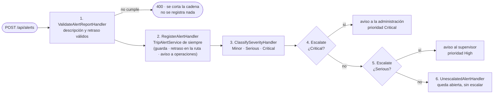
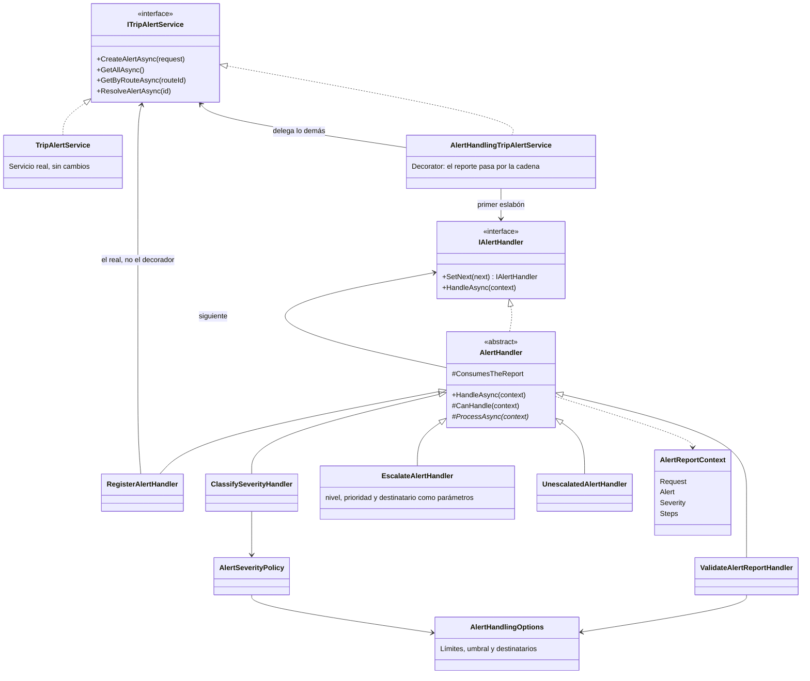
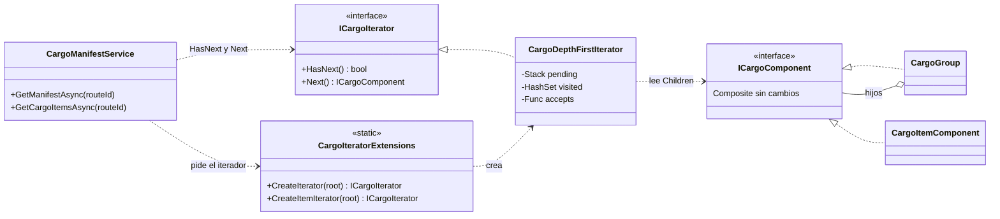
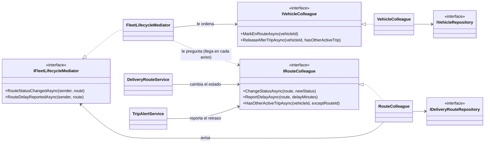
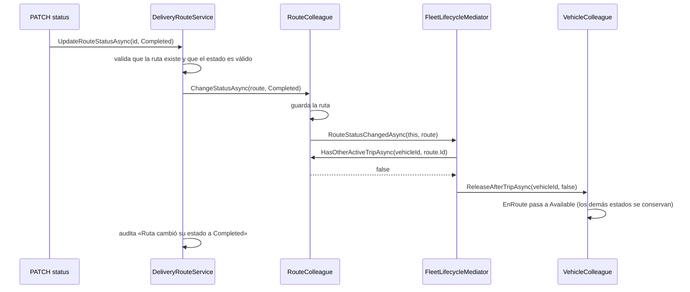
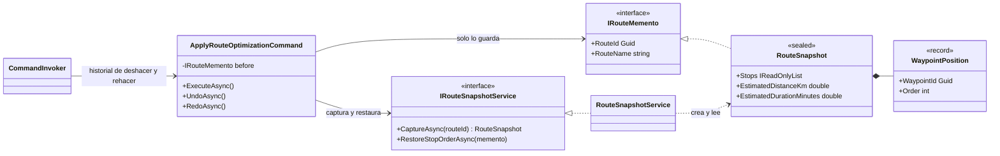

# 🚚 FleetControl — Sistema de Gestión de Flotas

Prototipo full-stack de un Sistema de Gestión de Flotas: monitoreo en tiempo real,
optimización de rutas y asignación de cargas, mantenimiento predictivo e integración
con sistemas de navegación. Incluye autenticación con dos roles (Administrador /
Operador), un dashboard administrativo y un portal para conductores.

> Construido como ejercicio de **Clean Architecture**, **SOLID** y **patrones de
> diseño creacionales** (Singleton, Factory Method, Abstract Factory, Builder y
> Prototype) sobre **C# / .NET 8**, con un frontend en HTML + CSS + JavaScript
> puro (sin frameworks) y mapas con **Leaflet.js**.

---

## Tabla de contenidos

1. [Descripción general y módulos funcionales](#1-descripción-general-y-módulos-funcionales)
2. [Stack tecnológico](#2-stack-tecnológico)
3. [Arquitectura (Clean Architecture)](#3-arquitectura-clean-architecture)
4. [Estructura de carpetas](#4-estructura-de-carpetas)
5. [Cómo ejecutar el proyecto](#5-cómo-ejecutar-el-proyecto)
6. [Credenciales de demostración](#6-credenciales-de-demostración)
7. [Principios SOLID aplicados](#7-principios-solid-aplicados)
8. [Patrones de diseño](#8-patrones-de-diseño)
   - [8.1 Singleton — `FleetAuditLogger`](#81-singleton--fleetauditlogger)
   - [8.2 Factory Method — Fábricas de vehículos](#82-factory-method--fábricas-de-vehículos)
   - [8.3 Abstract Factory — Fábrica de incorporación de flota](#83-abstract-factory--fábrica-de-incorporación-de-flota)
   - [8.4 Builder — Constructor de rutas](#84-builder--constructor-de-rutas)
   - [8.5 Prototype — Clonación de vehículos y rutas](#85-prototype--clonación-de-vehículos-y-rutas)
   - [8.6 Resumen de ubicaciones](#86-resumen-de-ubicaciones-de-los-patrones)
   - [8.7 Patrones estructurales: Adapter, Bridge, Composite y Decorator](#87-patrones-estructurales-adapter-bridge-composite-y-decorator)
   - [8.8 Decorator de reportes y Facade del resumen](#88-decorator-de-reportes-y-facade-del-resumen)
   - [8.9 Flyweight — perfiles compartidos por tipo de vehículo](#89-flyweight--perfiles-compartidos-por-tipo-de-vehículo)
   - [8.10 Proxy — caché del proveedor de navegación](#810-proxy--caché-del-proveedor-de-navegación)
   - [8.11 Strategy — optimizar paradas y repartir cargas](#811-strategy--optimizar-paradas-y-repartir-cargas)
   - [8.12 Decorator — reglas de asignación sobre el servicio de rutas](#812-decorator--reglas-de-asignación-sobre-el-servicio-de-rutas)
   - [8.13 Command — deshacer y rehacer operaciones de rutas](#813-command--deshacer-y-rehacer-operaciones-de-rutas)
   - [8.14 Chain of Responsibility — de la alerta reportada a quien debe atenderla](#814-chain-of-responsibility--de-la-alerta-reportada-a-quien-debe-atenderla)
   - [8.15 Iterator — recorrer la carga de una ruta sin conocer su estructura](#815-iterator--recorrer-la-carga-de-una-ruta-sin-conocer-su-estructura)
   - [8.16 Mediator — coordinar el estado de la ruta con el del vehículo](#816-mediator--coordinar-el-estado-de-la-ruta-con-el-del-vehículo)
   - [8.17 Memento — volver al orden anterior de las paradas](#817-memento--volver-al-orden-anterior-de-las-paradas)
9. [Documentación de la API REST](#9-documentación-de-la-api-rest)
10. [Notas sobre paso a producción](#10-notas-sobre-paso-a-producción)
11. [Limitaciones conocidas del prototipo](#11-limitaciones-conocidas-del-prototipo)
12. [Pruebas automatizadas y cómo demostrar el Factory Method](#12-pruebas-automatizadas-y-cómo-demostrar-el-factory-method)

---

## 1. Descripción general y módulos funcionales

| # | Módulo | Requerimiento | Dónde vive |
|---|--------|----------------|------------|
| 1 | **Monitoreo en tiempo real** | Ver ubicación y estado de cada vehículo (disponible / en ruta / mantenimiento / fuera de servicio) y su avance sobre la ruta asignada | `FleetController` + `TripProgressController` + `VehicleSimulationBackgroundService` + pestaña "Mapa y vehículos" del dashboard |
| 2 | **Optimización de rutas y asignación de cargas** | Crear rutas con paradas y artículos de carga y asignar vehículo/conductor **respetando las reglas** (capacidad en kg y m³, disponibilidad, mantenimiento vencido, sin doble asignación); **reordenar las paradas** de una ruta para recorrer menos kilómetros; **repartir un lote de entregas** entre los vehículos disponibles con un plan que se compara con el reparto simple; estimar distancia y tiempo con la velocidad del tipo de vehículo | `DeliveryRoutesController` + `DeliveryRouteService` (**Builder**) + `AssignmentValidatingRouteService` (**Decorator**, [8.12](#812-decorator--reglas-de-asignación-sobre-el-servicio-de-rutas)) + `DispatchController` y `RouteOptimizationController` (**Strategy**, [8.11](#811-strategy--optimizar-paradas-y-repartir-cargas)) + pestaña "Rutas y cargas" (botones "🧭 Planificar reparto" y "🧭 Optimizar") |
| 3 | **Mantenimiento predictivo** | Registrar mantenimientos y detectar cuáles vehículos tienen tareas vencidas por fecha o kilometraje | `MaintenanceController` + `MaintenanceService.GetVehiclesDueForMaintenanceAsync()` + pestaña "Mantenimiento" |
| 4 | **Integración con sistemas de navegación** | El conductor puede abrir la ruta asignada en una app de navegación real | `NavigationController` + `NavigationService` (genera enlace de Google Maps) + botón "Abrir navegación" en el portal del operador |

Además, el sistema incluye:

- **Autenticación con roles** (`AuthController`, `AuthService`) — Administrador y Operador.
- **Dashboard administrativo** de una sola página (SPA) con mapa, gestión de vehículos, rutas, mantenimiento, alertas y auditoría.
- **Portal del operador**: el conductor ve su ruta asignada, la carga a transportar, puede reportar una complicación durante el viaje (avería, retraso, tráfico, accidente, clima) y abrir la navegación externa.

---

## 2. Stack tecnológico

| Capa | Tecnología |
|------|------------|
| Backend | C# / **.NET 8**, ASP.NET Core Web API |
| "Base de datos" del prototipo | Colecciones en memoria (`ConcurrentDictionary`), thread-safe |
| Preparación para producción | `NetTopologySuite.Geometries.Point` para coordenadas + `FleetDbContext` (EF Core) listo para **PostgreSQL + PostGIS** |
| Frontend | HTML5, CSS3 (sistema de diseño propio, sin framework), JavaScript puro (Vanilla JS, `fetch`) |
| Mapas | **Leaflet.js** + teselas de OpenStreetMap |
| Documentación de API | Swagger / OpenAPI (`Swashbuckle.AspNetCore`) |

---

## 3. Arquitectura (Clean Architecture)

```
                ┌─────────────────────────────┐
                │   FleetManagement.Api       │  Controladores REST, Program.cs (DI),
                │   (ASP.NET Core Web API)    │  Middleware, Filtros
                └───────────────┬─────────────┘
                                │ depende de
                ┌───────────────▼─────────────┐
                │ FleetManagement.Infrastructure│ Repositorios en memoria, Singleton
                │                              │ (FleetAuditLogger), seguridad,
                │                              │ BackgroundService, FleetDbContext
                └───────────────┬─────────────┘
                                │ depende de
                ┌───────────────▼─────────────┐
                │ FleetManagement.Application  │ Casos de uso (Services), DTOs,
                │                              │ interfaces (repos/servicios),
                │                              │ Factories, Builders
                └───────────────┬─────────────┘
                                │ depende de
                ┌───────────────▼─────────────┐
                │   FleetManagement.Domain     │ Entidades, enums, IPrototype<T>
                │   (sin dependencias externas)│ (núcleo, no depende de nada más)
                └─────────────────────────────┘
```

La regla de dependencia se respeta en todo el proyecto: las flechas de dependencia
siempre apuntan hacia adentro (hacia `Domain`). `Domain` no conoce a `Application`;
`Application` no conoce a `Infrastructure` ni a `Api`. Esto es lo que permite, por
ejemplo, sustituir los repositorios en memoria por Entity Framework Core sin tocar
una sola línea de los casos de uso (ver [sección 10](#10-notas-sobre-paso-a-producción)).

---

## 4. Estructura de carpetas

```
FleetManagementSystem/
├── FleetManagementSystem.sln
├── README.md
├── src/
│   ├── FleetManagement.Domain/
│   │   ├── Common/IPrototype.cs                     ← contrato del patrón Prototype
│   │   ├── Cargo/ ← COMPOSITE de la carga (sección 8.7) e ITERATOR que la recorre (sección 8.15)
│   │   ├── Entities/ (Vehicle, DeliveryRoute, Driver, AppUser, Waypoint,
│   │   │              CargoItem, MaintenanceRecord, MaintenancePlan,
│   │   │              NavigationProfile, TripAlert)
│   │   └── Enums/Enums.cs
│   │
│   ├── FleetManagement.Application/
│   │   ├── Interfaces/Repositories/ (6 interfaces — DIP)
│   │   ├── Interfaces/Services/ (13 interfaces — DIP)
│   │   ├── Interfaces/ (IFleetAuditLogger, IPasswordHasher, ISessionTokenStore)
│   │   ├── DTOs/ (records de entrada/salida de la API)
│   │   ├── Factories/  ← FACTORY METHOD + ABSTRACT FACTORY
│   │   ├── Builders/   ← BUILDER
│   │   ├── Reports/    ← DECORATOR de reportes (generador base + decoradores, sección 8.8)
│   │   ├── Facades/    ← FACADE del resumen del dashboard (sección 8.8)
│   │   ├── Metrics/    ← FleetMetrics: cálculos que comparten el reporte y el resumen
│   │   ├── Geo/        ← GeoMath (Haversine, interpolación), TripEstimate (minutos = km / velocidad) y VehicleSpeed: compartidos por rutas, simulación y plan de reparto
│   │   ├── Assignment/ ← reglas de asignación (capacidad, disponibilidad, doble asignación) y el DECORATOR que las aplica (sección 8.12)
│   │   ├── Optimization/ ← STRATEGY: orden de las paradas, reparto de entregas y secuencia de cada viaje (sección 8.11)
│   │   ├── Commands/   ← COMMAND: órdenes que se pueden deshacer y rehacer, su invocador y el historial por usuario (sección 8.13); y el MEMENTO del orden de las paradas (sección 8.17)
│   │   ├── Mediators/  ← MEDIATOR: coordina el estado de la ruta con el de su vehículo (sección 8.16)
│   │   ├── AlertHandling/ ← CHAIN OF RESPONSIBILITY: validar, registrar, clasificar y escalar una alerta (sección 8.14)
│   │   ├── Simulation/ ← simulación del recorrido sobre la ruta asignada (secciones 5.3 y 10)
│   │   ├── Flyweights/ ← FLYWEIGHT: perfil compartido por tipo de vehículo (sección 8.9)
│   │   └── Services/   (servicios: casos de uso)
│   │
│   ├── FleetManagement.Infrastructure/
│   │   ├── Logging/FleetAuditLogger.cs  ← SINGLETON
│   │   ├── Persistence/ (6 repositorios en memoria + InMemoryDataSeeder + FleetDbContext)
│   │   ├── Security/ (PasswordHasher, InMemorySessionTokenStore)
│   │   ├── Navigation/ ← GoogleMapsAdapter (Adapter) + CachingNavigationProviderProxy y su caché (PROXY, sección 8.10)
│   │   ├── Simulation/ (InMemoryTripProgressTracker: avance de los viajes, en memoria)
│   │   ├── Commands/ (InMemoryCommandHistoryStore: un historial de órdenes por usuario, en memoria)
│   │   └── BackgroundServices/VehicleSimulationBackgroundService.cs  (temporizador de la simulación)
│   │
│   └── FleetManagement.Api/
│       ├── Program.cs                 ← Composition Root (Inyección de Dependencias)
│       ├── Controllers/ (16 controladores REST)
│       ├── Middleware/TokenAuthenticationMiddleware.cs
│       └── Filters/RequireRoleAttribute.cs
│
├── tests/
│   └── FleetManagement.Application.Tests/     ← pruebas xUnit de todo el proyecto (sección 12)
│       ├── Factories/, Builders/, Prototype/, Adapter/, Bridge/, Composite/, Decorator/, ReportDecorator/, Facade/
│       ├── Metrics/, Flyweight/, Proxy/, Simulation/, Geo/, Architecture/, Support/
│       ├── Assignment/    ← reglas de asignación y su Decorator (sección 8.12)
│       ├── Optimization/  ← Strategy: orden de paradas, reparto, plan y optimización de una ruta (sección 8.11)
│       ├── Command/       ← Command: historial, invocador, órdenes de rutas, foto de paradas y eliminador de rutas (sección 8.13)
│       ├── AlertHandling/ ← Chain of Responsibility: cadena, manejadores, política de gravedad, opciones y decorador (sección 8.14)
│       ├── Iterator/      ← Iterator: recorrido de la carga y lista plana de artículos (sección 8.15)
│       ├── Mediator/      ← Mediator: participantes, reglas ruta-vehículo, diseño e integración con servicios reales (sección 8.16)
│       └── Memento/       ← Memento: recuerdo, restauración, rechazos y su uso desde Command (sección 8.17)
│
└── frontend/
    ├── login.html
    ├── dashboard.html                 (panel administrativo — SPA)
    ├── operator.html                  (portal del conductor)
    ├── css/styles.css
    └── js/ (api.js, auth.js, dashboard.js, dispatch.js [plan de reparto y optimizar paradas], commands.js [deshacer y rehacer], operator.js)
```

---

## 5. Cómo ejecutar el proyecto

### 5.1 Backend

Requiere el **.NET 8 SDK** instalado y acceso a internet la primera vez (para que
NuGet descargue `NetTopologySuite`, `Microsoft.EntityFrameworkCore`,
`Npgsql.EntityFrameworkCore.PostgreSQL` y `Swashbuckle.AspNetCore`).

```bash
cd FleetManagementSystem

# Restaura los paquetes NuGet de los 4 proyectos
dotnet restore

# Ejecuta la API (por defecto en http://localhost:5080)
dotnet run --project src/FleetManagement.Api
```

Al iniciar, la aplicación:
1. Registra todas las dependencias (ver `Program.cs`).
2. Carga datos de demostración (`InMemoryDataSeeder`) con usuarios, vehículos, rutas
   y mantenimientos de ejemplo, usando coordenadas de Santander y otras ciudades de Colombia.
3. Expone Swagger en **http://localhost:5080/swagger** para explorar y probar cada endpoint.
4. Inicia el `VehicleSimulationBackgroundService`, que cada segundo avanza los vehículos
   "En ruta" a lo largo de su ruta asignada (origen → paradas → destino) para simular el
   tiempo real; un vehículo "En ruta" sin ruta activa no se mueve. Los parámetros se
   configuran como indica la [sección 5.3](#53-configuración-de-la-simulación-y-del-caché-de-navegación).

> Si NuGet no está accesible en su red corporativa/sandbox, configure un proxy o
> ejecute `dotnet restore` desde una red con salida a `api.nuget.org`.

### 5.2 Frontend

El frontend es HTML/CSS/JS estático — no requiere Node.js ni build. Basta con
abrir los archivos con un servidor estático simple (abrir el `.html` directamente
con doble clic también funciona en la mayoría de navegadores, gracias a que CORS
está configurado en el backend con `AllowAnyOrigin`).

Opción recomendada (evita restricciones de `file://` en algunos navegadores):

```bash
cd FleetManagementSystem/frontend
python3 -m http.server 8080
# Abrir http://localhost:8080/login.html
```

Si el backend corre en un host/puerto distinto de `http://localhost:5080`, ajuste
la constante `API_BASE_URL` en `frontend/js/api.js`.

### 5.3 Configuración de la simulación y del caché de navegación

Los parámetros de la simulación del recorrido y del caché del proxy de navegación
([sección 8.10](#810-proxy--caché-del-proveedor-de-navegación)) no están escritos dentro del
código: se leen de las secciones `Simulation` y `NavigationCache` de la configuración con el
patrón Options (`IOptions<T>`) y se **validan al arrancar**. Un valor imposible (por ejemplo,
`Simulation:TickSeconds` igual a 0) detiene la aplicación con un mensaje claro en lugar de
dejar una simulación congelada. `appsettings.json` no incluye estas secciones, así que, si no
se configuran, valen los valores por defecto:

| Clave | Por defecto | Qué controla |
|-------|-------------|--------------|
| `Simulation:TickSeconds` | `1` | Cada cuántos segundos reales avanza la simulación un paso (mayor que 0). |
| `Simulation:TimeAcceleration` | `1` | Cuántas veces más rápido que en la realidad se mueven los vehículos (mayor que 0). Con `1`, un vehículo que va a 100 km/h recorre 100 km en una hora real; con `10`, en 6 minutos. |
| `Simulation:DelayedSpeedFactor` | `0.5` | Fracción de la velocidad normal con la que avanza una ruta en estado `Delayed` (mayor que 0 y hasta 1). |
| `NavigationCache:TimeToLiveMinutes` | `10` | Minutos que se considera vigente una URL de navegación guardada (mayor que 0 y hasta 10 080, una semana). |
| `NavigationCache:MaxEntries` | `500` | Máximo de URLs guardadas a la vez (al menos 1). |

Las reglas de las alertas (`AlertHandling:*`: límites de la descripción y del retraso, umbral de retraso grave y destinatarios
del escalamiento) se leen y se validan de la misma manera; sus claves y valores por defecto están en la
[sección 8.14](#814-chain-of-responsibility--de-la-alerta-reportada-a-quien-debe-atenderla).

Para una demostración, lo más cómodo son las variables de entorno (el doble guion bajo
equivale a `:`). El viaje de demostración de `VAN-002` (6,955 km a 100 km/h) dura unos
4 min 10 s con la configuración por defecto y unos 25 s con aceleración 10:

```bash
# Git Bash / Linux / macOS
export Simulation__TimeAcceleration=10
dotnet run --project src/FleetManagement.Api
```

```powershell
# PowerShell
$env:Simulation__TimeAcceleration = "10"
dotnet run --project src/FleetManagement.Api
```

> `appsettings.json` ya traía la clave `FleetOptions:SimulationIntervalSeconds`, pero ningún
> código la leía (el intervalo de 5 segundos estaba escrito dentro del servicio de simulación).
> Sigue ahí, sin efecto y sin modificar; la clave que gobierna el intervalo ahora es
> `Simulation:TickSeconds`.

---

## 6. Credenciales de demostración

| Rol | Usuario | Contraseña | Vista |
|-----|---------|------------|-------|
| Administrador | `admin` | `Admin123!` | `dashboard.html` |
| Operador (conductor) | `operador1` | `Operador123!` | `operator.html` (tiene una ruta activa asignada) |
| Operador (conductor) | `operador2` | `Operador123!` | `operator.html` (tiene una ruta planificada) |

Las contraseñas se almacenan con hashing **PBKDF2** (`Rfc2898DeriveBytes`, 100.000
iteraciones, sal aleatoria por usuario) — ver `Infrastructure/Security/PasswordHasher.cs`.

---

## 7. Principios SOLID aplicados

| Principio | Cómo se aplica | Ejemplo / ruta |
|-----------|-----------------|-----------------|
| **S — Responsabilidad única** | Cada clase tiene un único motivo de cambio: los controladores sólo traducen HTTP↔DTOs, los servicios sólo orquestan reglas de negocio, los repositorios sólo persisten. | `Api/Controllers/FleetController.cs` (HTTP) vs. `Application/Services/VehicleService.cs` (negocio) vs. `Infrastructure/Persistence/InMemoryVehicleRepository.cs` (datos) |
| **O — Abierto/Cerrado** | Se puede agregar un nuevo tipo de vehículo creando una clase nueva (`IVehicleFactory`), sin modificar `VehicleService` ni `VehicleFactoryProvider` más que para registrarla. | `Application/Factories/ConcreteVehicleFactories.cs` |
| **L — Sustitución de Liskov** | Cualquier implementación de `IVehicleRepository`, `IDeliveryRouteBuilder` o `IVehicleFactory` puede sustituir a otra sin romper el comportamiento esperado por quien la consume (p. ej. `InMemoryVehicleRepository` podrá cambiarse por una implementación EF Core sin que `VehicleService` note la diferencia). | Todas las interfaces en `Application/Interfaces/**` |
| **I — Segregación de interfaces** | En vez de una única interfaz gigante de "repositorio genérico", cada agregado tiene su propia interfaz mínima (`IVehicleRepository`, `IMaintenanceRepository`, `ITripAlertRepository`, …), y cada caso de uso expone sólo los métodos que sus consumidores necesitan. | `Application/Interfaces/Repositories/*.cs` |
| **D — Inversión de dependencias** | Las capas externas dependen de abstracciones definidas por las capas internas, nunca al revés. `Program.cs` es el único lugar que conoce las implementaciones concretas. | `Program.cs` (Composition Root) + `Application/Interfaces/**` |

---

## 8. Patrones de diseño

Los cinco patrones solicitados están implementados, **conectados a un caso de uso
real** (no como código de ejemplo aislado) y expuestos a través de la API y la
interfaz gráfica, para que se puedan ejercitar de punta a punta.

### 8.1 Singleton — `FleetAuditLogger`

**Ruta:** `src/FleetManagement.Infrastructure/Logging/FleetAuditLogger.cs`
**Interfaz (DIP):** `src/FleetManagement.Application/Interfaces/IFleetAuditLogger.cs`
**Registro en DI:** `src/FleetManagement.Api/Program.cs`
**Consumido por:** `VehicleService`, `DeliveryRouteService`, `MaintenanceService`, `TripAlertService`, `AuthService`, y expuesto en `GET /api/audit/logs` (pestaña "Auditoría" del dashboard).

```csharp
public sealed class FleetAuditLogger : IFleetAuditLogger
{
    private static readonly Lazy<FleetAuditLogger> LazyInstance =
        new(() => new FleetAuditLogger(), LazyThreadSafetyMode.ExecutionAndPublication);

    public static FleetAuditLogger Instance => LazyInstance.Value;

    private readonly ConcurrentQueue<AuditLogEntryDto> _logs = new();
    private readonly object _writeLock = new();

    private FleetAuditLogger() { }   // constructor privado: única forma de obtenerlo es "Instance"

    public void LogEvent(string category, string message, string? username = null)
    {
        lock (_writeLock) { /* encola y recorta el historial */ }
    }
}
```

```csharp
// Program.cs — reconciliación del Singleton clásico con el contenedor de DI
builder.Services.AddSingleton<IFleetAuditLogger>(_ => FleetAuditLogger.Instance);
```

**Por qué este patrón:** el enunciado pide explícitamente un Singleton thread-safe
para auditar eventos críticos. Un logger de auditoría debe tener **una única
fuente de verdad** en todo el proceso: si cada clase creara su propia instancia,
el historial quedaría fragmentado y sería imposible tener una vista centralizada
de "qué pasó y cuándo" en el sistema.

**Por qué es thread-safe:** `Lazy<T>` con `LazyThreadSafetyMode.ExecutionAndPublication`
(el modo por defecto) garantiza que, aunque varios hilos pidan `Instance` al mismo
tiempo por primera vez, el constructor sólo se ejecuta una vez. El `lock` adicional
protege la operación compuesta "encolar + recortar historial", que si no fuera
atómica podría perder o duplicar el recorte bajo concurrencia real (varios
controladores auditando al mismo tiempo).

**Beneficio concreto:** cualquier parte del sistema —desde un login fallido hasta
un cambio de estado de un vehículo— escribe en el **mismo** registro, y el panel
de auditoría del administrador puede mostrar una línea de tiempo confiable de toda
la actividad del sistema con una sola consulta.

---

### 8.2 Factory Method — Fábricas de vehículos

**Ruta interfaz:** `src/FleetManagement.Application/Factories/IVehicleFactory.cs`
**Ruta implementaciones concretas:** `src/FleetManagement.Application/Factories/ConcreteVehicleFactories.cs` (`TruckFactory`, `VanFactory`, `CarFactory`, `MotorcycleFactory`)
**Ruta proveedor:** `src/FleetManagement.Application/Factories/VehicleFactoryProvider.cs`
**Consumido por:** `VehicleService.CreateVehicleAsync()` → expuesto en `POST /api/fleet/vehicles` (botón "+ Vehículo" del dashboard).

```csharp
public interface IVehicleFactory
{
    Vehicle CreateVehicle(string licensePlate, string brand, string model, int year, double latitude, double longitude);
}

public class TruckFactory : IVehicleFactory
{
    public Vehicle CreateVehicle(string licensePlate, string brand, string model, int year, double latitude, double longitude)
    {
        var vehicle = new Vehicle { /* ... */ Type = VehicleType.Truck, CapacityKg = 8000, Status = VehicleStatus.Available };
        vehicle.UpdateLocation(latitude, longitude);
        return vehicle;
    }
}
```

```csharp
// VehicleService.CreateVehicleAsync
var vehicleFactory = _vehicleFactoryProvider.GetFactory(vehicleType);
var vehicle = vehicleFactory.CreateVehicle(request.LicensePlate, request.Brand, request.Model,
                                            request.Year, request.Latitude, request.Longitude);
```

**Por qué este patrón:** cada tipo de vehículo (camión, furgoneta, automóvil,
motocicleta) necesita valores por defecto distintos (capacidad de carga, etc.).
Sin Factory Method, `VehicleService` tendría un `switch` con la lógica de creación
de los cuatro tipos, y cada vez que se agregara un tipo nuevo habría que **modificar**
esa clase (violando Open/Closed).

**Beneficio concreto:** para agregar, por ejemplo, un tipo `Trailer` en el futuro,
sólo hay que crear `TrailerFactory : IVehicleFactory` y añadir una línea al
diccionario de `VehicleFactoryProvider`. `VehicleService`, `FleetController` y
todo el resto del sistema permanecen intactos.

---

### 8.3 Abstract Factory — Fábrica de incorporación de flota

**Ruta interfaz:** `src/FleetManagement.Application/Factories/IFleetOnboardingAbstractFactory.cs`
**Ruta implementaciones concretas:** `src/FleetManagement.Application/Factories/ConcreteOnboardingFactories.cs` (`TruckOnboardingFactory`, `VanOnboardingFactory`, `CarOnboardingFactory`, `MotorcycleOnboardingFactory`)
**Ruta proveedor:** `src/FleetManagement.Application/Factories/FleetOnboardingFactoryProvider.cs`
**Consumido por:** `VehicleService.CreateVehicleAsync()` (mismo flujo que el Factory Method, un paso después).

```csharp
public interface IFleetOnboardingAbstractFactory
{
    MaintenancePlan CreateMaintenancePlan();      // Producto A de la familia
    NavigationProfile CreateNavigationProfile();  // Producto B de la familia
}

public class TruckOnboardingFactory : IFleetOnboardingAbstractFactory
{
    public MaintenancePlan CreateMaintenancePlan() => new() { /* tareas típicas de un camión */ };
    public NavigationProfile CreateNavigationProfile() => new() { AvoidLowBridges = true, MaxSpeedKmh = 80, /* ... */ };
}
```

```csharp
// VehicleService.CreateVehicleAsync — Factory Method y Abstract Factory trabajando juntos
var onboardingFactory = _onboardingFactoryProvider.GetFactory(vehicleType);
var maintenancePlan   = onboardingFactory.CreateMaintenancePlan();
var navigationProfile = onboardingFactory.CreateNavigationProfile();
```

**Diferencia clave con el Factory Method (8.2):** `IVehicleFactory` crea **un
solo producto** (el `Vehicle`). `IFleetOnboardingAbstractFactory` crea **una
familia de dos productos relacionados** (`MaintenancePlan` + `NavigationProfile`)
que **deben ser coherentes entre sí** para el mismo tipo de vehículo.

**Por qué este patrón:** sin Abstract Factory, nada impediría —por un error de
copiar/pegar— asignarle a un camión el plan de mantenimiento pensado para una
motocicleta (cada 2.000 km) junto con un perfil de navegación que sí evita puentes
bajos pero de una furgoneta. Al agrupar ambas fábricas por tipo de vehículo, la
familia completa se construye o no se construye: es imposible mezclar piezas de
familias distintas.

**Beneficio concreto:** al registrar un vehículo, el sistema dota automáticamente
al vehículo de un plan de mantenimiento y un perfil de navegación **consistentes
con su tipo**, sin que el desarrollador tenga que recordar combinarlos a mano en
cada punto del código donde se crea un vehículo.

---

### 8.4 Builder — Constructor de rutas

**Ruta interfaz:** `src/FleetManagement.Application/Builders/IDeliveryRouteBuilder.cs`
**Ruta implementación:** `src/FleetManagement.Application/Builders/DeliveryRouteBuilder.cs`
**Ruta Director (opcional):** `src/FleetManagement.Application/Builders/DeliveryRouteDirector.cs`
**Consumido por:** `DeliveryRouteService.CreateRouteAsync()` → `POST /api/routes` (botón "+ Nueva ruta"); `DeliveryRouteService.CreateExpressRouteAsync()` → `POST /api/routes/express` (botón "⚡ Ruta express", usa el Director).

```csharp
public interface IDeliveryRouteBuilder
{
    IDeliveryRouteBuilder WithName(string name);
    IDeliveryRouteBuilder WithOrigin(double latitude, double longitude);
    IDeliveryRouteBuilder WithDestination(double latitude, double longitude);
    IDeliveryRouteBuilder AddWaypoint(double latitude, double longitude, string label);
    IDeliveryRouteBuilder AddCargoItem(string description, double weightKg, double volumeM3, CargoPriority priority);
    IDeliveryRouteBuilder AssignVehicle(Guid vehicleId);
    IDeliveryRouteBuilder AssignDriver(Guid driverId);
    IDeliveryRouteBuilder ScheduleFor(DateTime date);
    IDeliveryRouteBuilder WithEstimatedTrip(double distanceKm, double durationMinutes);
    DeliveryRoute Build();  // valida (nombre, origen y destino obligatorios) antes de entregar el objeto
}
```

```csharp
// DeliveryRouteService.CreateRouteAsync — construcción paso a paso con partes opcionales
var builder = _routeBuilder.WithName(request.Name)
                            .WithOrigin(request.OriginLat, request.OriginLng)
                            .WithDestination(request.DestinationLat, request.DestinationLng);

foreach (var wp in request.Waypoints ?? new())
    builder = builder.AddWaypoint(wp.Latitude, wp.Longitude, wp.Label);

foreach (var cargo in request.CargoItems ?? new())
    builder = builder.AddCargoItem(cargo.Description, cargo.WeightKg, cargo.VolumeM3, priority);

var route = builder.Build();
```

**Por qué este patrón:** una ruta puede tener cero o varias paradas intermedias,
cero o varios artículos de carga, y asignaciones de vehículo/conductor opcionales.
Representar todas esas combinaciones con un único constructor produciría una firma
de 10+ parámetros (muchos opcionales/`null`) difícil de leer y de invocar
correctamente. El Builder permite **agregar sólo lo que aplica**, en el orden que
convenga, y **validar el resultado en `Build()`** antes de entregarlo.

**El Director (`DeliveryRouteDirector`):** encapsula una "receta" reutilizable
—una ruta express con carga urgente y salida inmediata— para no repetir la misma
secuencia de llamadas al builder en cada lugar donde se necesite ese caso común.

**Beneficio concreto:** `DeliveryRouteService` arma la ruta con un bucle simple
sobre las paradas y la carga que vinieron en la petición HTTP, sin `if`s anidados
ni un DTO gigante con decenas de campos opcionales, y `Build()` impide crear una
ruta sin nombre, origen o destino.

---

### 8.5 Prototype — Clonación de vehículos y rutas

**Ruta interfaz:** `src/FleetManagement.Domain/Common/IPrototype.cs`
**Implementaciones:** `Vehicle.Clone()` en `src/FleetManagement.Domain/Entities/Vehicle.cs`; `DeliveryRoute.Clone()` (+ `Waypoint.Clone()`, `CargoItem.Clone()`) en `src/FleetManagement.Domain/Entities/DeliveryRoute.cs`, `Waypoint.cs`, `CargoItem.cs`.
**Consumido por:** `VehicleService.CloneVehicleAsync()` → `POST /api/fleet/vehicles/{id}/clone` (botón ⧉ junto a cada vehículo); `DeliveryRouteService.DuplicateRouteAsync()` → `POST /api/routes/{id}/duplicate` (botón "⧉ Duplicar" en cada ruta, para rutas recurrentes).

```csharp
public interface IPrototype<T>
{
    T Clone();
}

public class Vehicle : IPrototype<Vehicle>
{
    public Vehicle Clone() => new()
    {
        Id = Guid.NewGuid(),                 // nueva identidad: es una unidad física distinta
        LicensePlate = string.Empty,         // debe asignarse individualmente
        Brand = Brand, Model = Model, Type = Type, CapacityKg = CapacityKg,
        Status = VehicleStatus.Available,
        MileageKm = 0,
        CurrentLocation = new Point(CurrentLocation.X, CurrentLocation.Y) { SRID = 4326 }, // copia profunda
        AssignedDriverId = null,
        RegisteredAt = DateTime.UtcNow
    };
}
```

```csharp
public class DeliveryRoute : IPrototype<DeliveryRoute>
{
    public DeliveryRoute Clone() => new()
    {
        Id = Guid.NewGuid(),
        Waypoints = Waypoints.Select(w => w.Clone()).ToList(),   // copia profunda de la lista
        CargoItems = CargoItems.Select(c => c.Clone()).ToList(), // ídem
        // ... vehículo/conductor NO se copian, para no duplicar una asignación por accidente
    };
}
```

**Por qué este patrón:** dar de alta 10 camionetas idénticas de flota, o programar
"la misma ruta de reparto" todos los días, son operaciones frecuentes en un
sistema de logística real. Reconstruir cada vez la entidad completa desde cero
—sobre todo una ruta, que tiene listas anidadas de paradas y artículos de
carga— es repetitivo y propenso a errores de captura.

**Por qué la copia debe ser profunda (deep copy):** si `Clone()` simplemente
copiara la referencia a la lista `Waypoints`, modificar las paradas del clon
también modificaría las de la ruta original (serían la misma lista en memoria).
Por eso cada elemento de las colecciones también implementa `IPrototype<T>` y se
clona individualmente (`Waypoints.Select(w => w.Clone())`).

**Qué se copia y qué no (decisión de diseño explícita):** los datos "de plantilla"
(marca, modelo, tipo, paradas, artículos de carga) sí se copian; la identidad, la
placa, el kilometraje, el historial de mantenimiento y las asignaciones de
vehículo/conductor **no** se copian, porque cada clon es una entidad físicamente
distinta que aún no debería competir por los mismos recursos que el original.

**Beneficio concreto:** onboarding de flota y programación de rutas recurrentes
pasan de "volver a diligenciar todos los campos" a "clonar y ajustar dos datos".

---

### 8.6 Resumen de ubicaciones de los patrones

| Patrón | Endpoint que lo ejercita | Botón en la UI |
|--------|---------------------------|----------------|
| Singleton (`FleetAuditLogger`) | `GET /api/audit/logs` | Pestaña "Auditoría" |
| Factory Method (`IVehicleFactory`) | `POST /api/fleet/vehicles` | "+ Vehículo" |
| Abstract Factory (`IFleetOnboardingAbstractFactory`) | `POST /api/fleet/vehicles` (mismo endpoint, un paso después del Factory Method) | "+ Vehículo" |
| Builder (`IDeliveryRouteBuilder` + `DeliveryRouteDirector`) | `POST /api/routes` y `POST /api/routes/express` (el panel usa sus versiones con historial, `/api/commands/routes` y `/api/commands/routes/express`, que llaman al mismo servicio) | "+ Nueva ruta" / "⚡ Ruta express" |
| Prototype (`IPrototype<T>`) | `POST /api/fleet/vehicles/{id}/clone` y `POST /api/routes/{id}/duplicate` (el panel usa la versión con historial, `/api/commands/routes/{id}/duplicate`, que llama al mismo servicio) | ⧉ junto a cada vehículo / ruta |
| Adapter (`INavigationProvider` + `GoogleMapsAdapter`) | `GET /api/navigation/route/{routeId}` | Enlace de navegación de la ruta |
| Bridge (`FleetNotification` + `INotificationChannel`) | `POST /api/maintenance`, `POST /api/alerts`, `PATCH /api/fleet/vehicles/{id}/status` (el envío simulado aparece en la consola del backend) | — |
| Composite (`ICargoComponent` / `CargoGroup`) | `GET /api/routes/{id}/cargo-manifest` | — |
| Decorator (`NotificationDecorator`: Audit, Retry, Priority) | Los mismos endpoints que el Bridge; el resultado queda en `GET /api/audit/logs` | Pestaña "Auditoría" |
| Decorator de reportes (`FleetReportDecorator`: Statistics, MaintenanceAlerts, CargoSummary) | `GET /api/reports/fleet?sections=...` | — |
| Facade (`FleetDashboardFacade`) | `GET /api/dashboard/summary` | — |
| Flyweight (`IVehicleTypeProfileFactory` → `VehicleTypeProfile`) | `GET /api/fleet/vehicle-types`; además lo usa por dentro el simulador, cuyo resultado se ve en `GET /api/progress` | Marcadores del mapa (un ícono compartido por tipo y estado) |
| Proxy (`CachingNavigationProviderProxy`) | `GET /api/navigation/route/{routeId}` (el mismo endpoint del Adapter: la segunda consulta de la misma ruta sale del caché) | Enlace de navegación de la ruta |
| Strategy (`IRouteOptimizer`, `ICargoAssignmentStrategy`, `IStopSequencer`) | `POST /api/dispatch/plan`, `POST /api/dispatch/apply`, `GET` y `POST /api/routes/{id}/optimization` | "🧭 Planificar reparto" / "🧭 Optimizar" |
| Decorator de reglas de asignación (`AssignmentValidatingRouteService`) | `POST /api/routes`, `POST /api/routes/express`, `PATCH /api/routes/{id}/status` (responden 400 con los mensajes de las reglas incumplidas) | "+ Nueva ruta" (aviso rojo de capacidad), cambio de estado de la ruta |
| Command (`ICommand<T>` / `IUndoableCommand<T>` + `CommandInvoker`) | `POST /api/commands/routes`, `POST /api/commands/routes/express`, `POST /api/commands/routes/{id}/duplicate`, `POST /api/commands/routes/{id}/optimization`, `POST /api/commands/dispatch/apply`, `GET /api/commands/history`, `POST /api/commands/undo`, `POST /api/commands/redo` | «+ Nueva ruta», «⚡ Ruta express», «⧉ Duplicar», «Crear rutas del plan», «Aplicar este orden» y los botones «↶ Deshacer» / «↷ Rehacer» |
| Chain of Responsibility (`IAlertHandler` + `AlertHandlingTripAlertService`) | `POST /api/alerts` (la alerta pasa por la cadena; las graves y críticas generan un aviso de escalamiento visible en `GET /api/audit/logs`) | «🚨 Reportar complicación» del portal del conductor |
| Iterator (`ICargoIterator` + `CargoDepthFirstIterator`) | `GET /api/routes/{id}/cargo-items` (los mismos artículos del `cargo-manifest`, como lista plana en el orden del recorrido) | — |
| Mediator (`IFleetLifecycleMediator` + `IRouteColleague` / `IVehicleColleague`) | `PATCH /api/routes/{id}/status` (el vehículo asignado queda En ruta o Disponible según el estado) y `POST /api/alerts` con retraso (la ruta queda Retrasada) | Cambio de estado de la ruta y «🚨 Reportar complicación» |
| Memento (`IRouteMemento` / `RouteSnapshot` + `IRouteSnapshotService`) | `POST /api/commands/routes/{id}/optimization` guarda el recuerdo; `POST /api/commands/undo` y `POST /api/commands/redo` lo usan | «Aplicar este orden», «↶ Deshacer» y «↷ Rehacer» |

### 8.7 Patrones estructurales: Adapter, Bridge, Composite y Decorator

| Patrón | Dónde está | Qué resuelve |
|--------|------------|--------------|
| **Adapter** | `Application/Interfaces/INavigationProvider` (Target), `Infrastructure/Navigation/GoogleMapsAdapter` (Adapter), `GoogleMapsApi` (Adaptee); cliente: `NavigationService` | Desacopla la navegación de Google Maps: integrar otro proveedor sólo requiere otro adapter. |
| **Bridge** | `Application/Notifications/FleetNotification` y sus especializaciones (`Maintenance`, `TripAlert`, `Vehicle`); `Interfaces/INotificationChannel` y los canales Email/SMS/Push en `Infrastructure/Notifications` | Separa *qué* se notifica de *por dónde* se envía, sin una clase por cada combinación. |
| **Composite** | `Domain/Cargo/` (`ICargoComponent`, `CargoItemComponent`, `CargoGroup`, `CargoManifest`), `Application/Services/CargoManifestService`, `Api/Controllers/CargoManifestController` | Trata de forma uniforme un artículo de carga y grupos de cargas anidados: manifiesto de la ruta agrupado por prioridad, con pesos y volúmenes totales. |
| **Decorator** | `Application/Notifications/INotification` y `Application/Notifications/Decorators/` (`Audit`, `Retry`, `Priority`) | Añade auditoría, reintentos y prioridad a una notificación sin modificar sus clases ni el canal. |

Los cuatro conviven con los patrones creacionales sin reemplazarlos: el Composite sólo
**lee** las rutas que construyen Builder y Prototype (`CargoItem` no se modificó; la hoja
`CargoItemComponent` lo envuelve), y el Decorator **envuelve** la notificación del Bridge
(el único cambio en esas clases es que `FleetNotification` implementa `INotification`).

Ejemplo de Bridge + Decorator, tal como lo usan `MaintenanceService`, `TripAlertService` y `VehicleService`:

```csharp
await new MaintenanceNotification(channel, recipient, plate, type, dueDate, dueKm) // Bridge: qué + por qué canal
    .WithPriority(NotificationPriority.Normal)   // Decorator: prioridad (también decide cuántos reintentos)
    .WithRetry()                                 // Decorator: reintenta si el canal falla
    .WithAudit(auditLogger)                      // Decorator: registra resultado y errores en la bitácora
    .SendAsync();
```

Orden recomendado: `Priority` dentro de `Retry`, y `Retry` dentro de `Audit` (el primero que se
escribe queda más adentro). Detalle y diagramas en la documentación técnica de la integración.

### 8.8 Decorator de reportes y Facade del resumen

Se agregaron **de forma aditiva**: ningún patrón anterior se reemplazó ni se reescribió. El único archivo
existente que cambió en `src/` es `Program.cs` (dos `using` y tres registros de DI); todo lo demás es código nuevo.

| Patrón | Dónde está | Qué resuelve |
|--------|------------|--------------|
| **Decorator (reportes)** | `Application/Reports/` (`IFleetReportGenerator` = Componente, `FleetReportGenerator` = Componente concreto), `Application/Reports/Decorators/` (`FleetReportDecorator` = Decorador base; `StatisticsReportDecorator`, `MaintenanceAlertsReportDecorator`, `CargoSummaryReportDecorator`), `Application/Services/FleetReportService`, `Api/Controllers/ReportsController` | Añade secciones opcionales a un reporte base (vehículos y rutas) sin modificar el generador base ni las demás secciones, y en el orden que pida el cliente. |
| **Facade** | `Application/Facades/` (`IFleetDashboardFacade`, `FleetDashboardFacade`), `Api/Controllers/DashboardController` | Una sola llamada coordina los servicios de vehículos, rutas, mantenimiento y alertas para armar el resumen del dashboard; los servicios siguen siendo la única fuente de cada dato. |

Es independiente del Decorator de notificaciones de la sección 8.7 (otro componente, otras clases). Las cifras que
comparten el reporte y el resumen —estadísticas, totales de carga, mantenimientos vencidos y conteo por estado— se
calculan en un único lugar, `Application/Metrics/FleetMetrics`, para que ambos den exactamente los mismos números
sin repetir lógica. Los datos salen siempre de los servicios y repositorios existentes: no se inventó ningún campo.

```csharp
// El primero que se escribe queda más adentro (igual que en el Decorator de notificaciones).
IFleetReportGenerator report =
    new CargoSummaryReportDecorator(
        new MaintenanceAlertsReportDecorator(
            new StatisticsReportDecorator(baseGenerator), maintenanceService));
FleetReportDto dto = await report.GenerateAsync();
```

En la API, `FleetReportService` arma esa cadena en cada petición según `sections`; en DI sólo está registrado
el generador base.

| Endpoint | Resultado |
|----------|-----------|
| `GET /api/reports/fleet` | Reporte base: `metadata`, `vehicles` y `routes`. |
| `GET /api/reports/fleet?sections=Statistics,MaintenanceAlerts,CargoSummary` | Lo anterior más `statistics`, `maintenanceAlerts` y `cargoSummary`. Las secciones pueden ir separadas por comas o repetirse (`sections=A&sections=B`), sin distinguir mayúsculas. Una sección desconocida (o un número) devuelve `400` con `{ "message": ... }` que lista los valores válidos. |
| `GET /api/dashboard/summary` | `generatedAtUtc`, `statistics`, `cargo`, `overdueMaintenanceCount` y `alertsByStatus`. |

Límites a tener en cuenta:

- El módulo de mantenimiento sólo expone los elementos **vencidos**; el modelo no tiene un concepto de «pendientes» o
  «próximos», así que no se muestran (no se inventaron).
- Añadir un decorador que aporte un tipo de sección **nuevo** exige una propiedad anulable en `FleetReportDto`, un valor
  en `ReportSection` y una línea en el `switch` de `FleetReportService`; el generador base y los demás decoradores no cambian.
- Los dos endpoints son de sólo lectura y, como el resto de las consultas `GET`, no exigen rol (ver sección 9).
- El frontend todavía no consume estos endpoints: se pueden probar con Swagger o `curl`.

### 8.9 Flyweight — perfiles compartidos por tipo de vehículo

Se agregó **de forma aditiva**, junto con la simulación del recorrido (secciones 5.3 y 10): ninguna clase de los
patrones anteriores se modificó. El Abstract Factory (`FleetOnboardingFactoryProvider` y sus fábricas),
`VehicleService` y `FleetController` siguen exactamente como estaban; `VehicleService.CreateVehicleAsync` sigue
creando, con el Abstract Factory, el `NavigationProfile` y el `MaintenancePlan` propios de cada vehículo nuevo.

| Pieza | Dónde está | Papel |
|-------|------------|-------|
| `VehicleTypeProfile` | `Application/Flyweights/VehicleTypeProfile.cs` | **Flyweight**: perfil inmutable que comparten todos los vehículos de un mismo tipo (nombre del perfil, velocidad máxima, restricciones de navegación y plantillas de mantenimiento). |
| `IVehicleTypeProfileFactory` / `VehicleTypeProfileFactory` | `Application/Flyweights/` | **Fábrica de flyweights**: `GetProfile(VehicleType)` devuelve siempre la **misma instancia** para un tipo (`ConcurrentDictionary<VehicleType, Lazy<…>>`, segura para varios hilos). |
| `Vehicle` y `TripProgress` | `Domain/Entities/Vehicle.cs`, `Application/Simulation/TripProgress.cs` | **Estado extrínseco**: placa, posición, estado, kilometraje y avance del viaje. Cambia por vehículo y no se comparte. |
| Consumidores | `VehicleMovementSimulator`, `TripProgressService` y `VehicleTypeService` (con `GET /api/fleet/vehicle-types`) | Solo **leen** el perfil: nadie lo reconstruye ni lo modifica. |
| Frontend | `frontend/js/dashboard.js` (`vehicleIconCache`, `vehicleDivIcon`) | El mismo patrón en el cliente: un solo ícono de Leaflet (`L.divIcon`) por combinación tipo + estado, compartido por todos los marcadores. |

**Estado intrínseco y extrínseco.** Lo que es igual para cualquier vehículo de un tipo (la velocidad máxima de un
camión, evitar puentes bajos, sus tareas de mantenimiento) es *intrínseco* y vive en el perfil compartido. Lo que
cambia de un vehículo a otro (placa, dónde está, cuántos kilómetros lleva, cuánto de su ruta ha recorrido) es
*extrínseco* y se queda en el vehículo.

| Tipo | Perfil | Velocidad máxima |
|------|--------|------------------|
| `Truck` | Perfil Camión de Carga | 80 km/h |
| `Van` | Perfil Furgoneta de Reparto | 100 km/h |
| `Car` | Perfil Vehículo Liviano | 120 km/h |
| `Motorcycle` | Perfil Motocicleta de Mensajería | 80 km/h |

**Qué ahorra y qué no.** Con cuatro tipos de vehículo el ahorro de memoria es **pequeño**: son cuatro objetos chicos,
y construirlos de nuevo en cada uso costaría microsegundos. Presentarlo como una optimización de memoria sería
exagerar. El patrón se justifica aquí por otras tres razones, que sí aplican:

1. **Una sola fuente de verdad.** El simulador (cuánto avanza cada vehículo), el servicio de progreso (cuántos
   minutos faltan) y el endpoint de tipos leen la misma velocidad del mismo objeto. La ETA que ve el usuario sale de
   la misma función de velocidad que mueve al vehículo (`TripSpeed`), así que no pueden contradecirse.
2. **No reconstruir en cada ciclo.** La simulación corre cada segundo para todos los viajes activos. Pedir el perfil
   es una consulta a un diccionario; el Abstract Factory, en cambio, crea objetos nuevos (`NavigationProfile`,
   `MaintenancePlan`) cada vez que se le pide.
3. **Escalabilidad.** Si el catálogo creciera (por ejemplo, un perfil por modelo con tablas de mantenimiento largas),
   compartir una instancia por clave sí ahorraría memoria de forma medible; el diseño ya está listo para eso.

**Relación con el Abstract Factory.** `VehicleTypeProfileFactory` no repite los valores: los lee de
`FleetOnboardingFactoryProvider` (sin modificarlo) y los **copia** a records inmutables. Los productos de ese
Abstract Factory (`NavigationProfile`, `MaintenancePlan`) son clases mutables, así que se descartan después de
copiarlos: compartirlos rompería el patrón, porque cualquier consumidor podría alterarlos para todos los demás. Una
prueba comprueba que cada perfil coincide con lo que entrega el Abstract Factory.

```csharp
// En el simulador: la velocidad sale del perfil compartido del tipo, no de un objeto creado para la ocasión.
var profile = _profiles.GetProfile(trip.Vehicle.Type);                      // siempre la misma instancia por tipo
var speedKmh = TripSpeed.KmPerHour(profile, trip.Route.Status, _options);  // perfil × retraso × aceleración
```

```javascript
// dashboard.js — un ícono por combinación tipo|estado, reutilizado por todos los marcadores
const vehicleIconCache = new Map();
function vehicleDivIcon(vehicle) {
  const key = `${vehicle.type}|${vehicle.status}`;
  if (!vehicleIconCache.has(key)) vehicleIconCache.set(key, createVehicleDivIcon(vehicle));
  return vehicleIconCache.get(key);
}
```

En el cliente el caché tiene además un efecto práctico: Leaflet rehace el elemento del marcador cada vez que recibe un
ícono distinto, por eso el dashboard llama a `setIcon` solo cuando el ícono cambió de verdad (así no se corta el
deslizamiento suave del marcador entre dos lecturas).

**Límites.** Un Flyweight solo es seguro mientras sea inmutable: por eso `VehicleTypeProfile` no tiene setters y copia
su lista de tareas a una colección de solo lectura. Los perfiles no cambian mientras la aplicación corre; si algún día
hicieran falta cambios en caliente, habría que **reemplazar** la instancia, nunca modificarla.

**Cómo comprobarlo.** `GET /api/fleet/vehicle-types` devuelve los cuatro perfiles con su velocidad máxima, y
`GET /api/progress` muestra al simulador usándolos: la ETA de un viaje es `kilómetros restantes / velocidad del tipo`
(ajustada por retraso y aceleración). Las pruebas de `Flyweight/` verifican con `Assert.Same` que el mismo tipo
devuelve siempre la misma instancia, también desde muchos hilos a la vez (`Parallel.For`).

### 8.10 Proxy — caché del proveedor de navegación

Se agregó **de forma aditiva**: `NavigationService`, `GoogleMapsAdapter` y `GoogleMapsApi` **no se modificaron**. Fuera
del código nuevo, lo único que cambió es el registro de `INavigationProvider` en `Program.cs`.

| Pieza | Dónde está | Papel |
|-------|------------|-------|
| `INavigationProvider` | `Application/Interfaces/` (ya existía) | **Interfaz del sujeto**: la misma que usa `NavigationService`. El proxy la implementa, así que el cliente no nota la diferencia. |
| `GoogleMapsAdapter` | `Infrastructure/Navigation/` (sin cambios) | **Sujeto real**: genera la URL de Google Maps. |
| `CachingNavigationProviderProxy` | `Infrastructure/Navigation/` | **Proxy de caché**: si la misma ruta ya se pidió hace poco, devuelve la URL guardada y no llega al sujeto real. |
| `NavigationCacheKey` | `Infrastructure/Navigation/` | Clave de una ruta: origen + paradas en orden de visita + destino. |
| `ExpiringUrlCache` | `Infrastructure/Navigation/` | Almacén con vencimiento y tamaño máximo, seguro para varios hilos. |
| `NavigationCacheOptions` | `Infrastructure/Navigation/` | Tiempo de vida y tamaño máximo, configurables ([sección 5.3](#53-configuración-de-la-simulación-y-del-caché-de-navegación)). |

El Adapter pasa a registrarse como clase concreta y `INavigationProvider` se construye con una fábrica que lo envuelve
(`Program.cs`):

```csharp
builder.Services.AddSingleton<GoogleMapsAdapter>();
// ... opciones validadas de "NavigationCache" y TimeProvider.System ...
builder.Services.AddSingleton<INavigationProvider>(provider => new CachingNavigationProviderProxy(
    provider.GetRequiredService<GoogleMapsAdapter>(),
    provider.GetRequiredService<NavigationCacheOptions>(),
    provider.GetRequiredService<TimeProvider>()));
```

**Qué pasa en una consulta.**

1. `NavigationService` pide la URL a su `INavigationProvider`, que ahora es el proxy.
2. El proxy calcula la `NavigationCacheKey` de la ruta.
3. Si hay una entrada **vigente** con esa clave, devuelve esa URL y **no llama** al sujeto real.
4. Si no, llama al Adapter, guarda la URL con su tiempo de vida y la devuelve.

**La clave.** Dos pedidos comparten entrada solo si el proveedor real devolvería la misma URL:

- Origen, destino y paradas **en el orden en que se visitan** (se ordenan por `Order`, igual que hace el Adapter).
- Coordenadas redondeadas a **6 decimales** (~11 cm) y formateadas con la **cultura invariante** (con coma decimal las
  claves cambiarían de un equipo a otro). `-0` y `0` dan la misma clave.
- **No** entran la etiqueta de las paradas, el nombre de la ruta ni los valores absolutos de `Order`, porque no afectan a
  la URL de Google Maps: dos rutas con otro nombre y otras etiquetas, pero la misma geometría, comparten entrada.

**Vencimiento y tamaño.** Una entrada vence cuando `ahora ≥ creación + NavigationCache:TimeToLiveMinutes` (el reloj es un
`TimeProvider` inyectado: las pruebas lo adelantan a mano en vez de esperar). Al llegar a `NavigationCache:MaxEntries` se
retiran primero las entradas vencidas y, si sigue lleno, la más antigua. Una URL vencida nunca se devuelve.

**Proxy frente a Decorator.** Estructuralmente se parecen (los dos envuelven un objeto con su misma interfaz), pero la
intención es distinta:

| | Decorators del proyecto (notificaciones y reportes) | Proxy de caché |
|---|---|---|
| Intención | **Añadir responsabilidades** funcionales al objeto envuelto: reintentar, auditar, dar prioridad, agregar secciones a un reporte. | **Controlar el acceso** al sujeto real: decidir si y cuándo se le llama. |
| Efecto en el resultado | El resultado cambia o se enriquece. | Ninguno: devuelve exactamente lo que daría el sujeto real. |
| Composición | Se apilan y combinan en el orden que elige quien los arma (`.WithPriority().WithRetry().WithAudit()`). | Uno solo, fijo, decidido en el Composition Root. |
| Quién lo conoce | Quien los arma decide cuáles aplicar. | El cliente (`NavigationService`) no sabe que existe. |
| Ciclo de vida | Por operación o por petición. | **Singleton**: guarda estado (el caché); con otro ciclo de vida cada petición tendría un caché vacío. |

**Compromisos asumidos** (decisiones conscientes, no descuidos):

- **Sin coalescencia de pedidos simultáneos.** Si dos peticiones piden a la vez una ruta que todavía no está en el
  caché, las dos pueden llegar al proveedor (una vez cada una). Es aceptable porque generar la URL no tiene efectos
  secundarios; evitarlo exigiría coordinar los pedidos en vuelo, más complejidad de la que este caso justifica.
- **Caché de memoria, por proceso.** No se comparte entre instancias de la API ni sobrevive a un reinicio. Con varias
  instancias haría falta un caché distribuido detrás de la misma interfaz.
- **Los errores no se guardan.** Si el proveedor falla, la excepción llega al cliente tal cual y el siguiente pedido lo
  intenta de nuevo.
- **Redondeo a 6 decimales.** Dos puntos a menos de ~11 cm comparten URL; para una app de navegación es irrelevante,
  pero es una decisión consciente.
- **El beneficio práctico de hoy es pequeño.** `GoogleMapsApi.BuildDirectionsUrl` solo arma una cadena en memoria: no
  hay red, cuota ni latencia que ahorrar. El proxy se justifica cuando el proveedor sea remoto (por ejemplo, una API de
  direcciones con cuota y costo por consulta); como es transparente, entonces bastará con cambiar el sujeto que envuelve.

**Cómo comprobarlo.** Como el proxy es transparente, el endpoint `GET /api/navigation/route/{routeId}` responde igual con
o sin él, así que la evidencia no está en la respuesta sino en las pruebas, que cuentan cuántas veces se llama al
sujeto: `dotnet test --filter "FullyQualifiedName~Proxy"`. Cubren que la segunda consulta idéntica no llega al sujeto, que
una clave distinta sí, el vencimiento por tiempo de vida (con un reloj manual), el tamaño máximo, que los errores no se
guardan, la transparencia frente al `GoogleMapsAdapter` real y el conjunto con el `NavigationService` real.

### 8.11 Strategy — optimizar paradas y repartir cargas

Requerimiento #2 (optimización de rutas y asignación de cargas). Hay tres decisiones que se pueden resolver de más de una
manera, y cada una es una **estrategia intercambiable** detrás de una interfaz: el Composition Root (`Program.cs`) elige
cuál se usa y los servicios no lo saben. Viven en `Application/Optimization/` y son **puras** (reciben datos y devuelven un
resultado, sin repositorios ni reloj), por eso se prueban sin infraestructura.

| Estrategia (interfaz) | Implementaciones | Qué decide |
|-----------------------|------------------|------------|
| `IRouteOptimizer` | `NearestNeighborRouteOptimizer` (vecino más cercano) · `TwoOptRouteOptimizer` (recibe otro optimizador como punto de partida y lo mejora con 2-opt) | En qué **orden** visitar unas paradas desde un origen, con o sin destino fijo. |
| `ICargoAssignmentStrategy` | `PriorityBestFitStrategy` (la del plan) · `FirstFitInOrderStrategy` (la línea base "sin optimizar") | A qué **vehículo** va cada entrega. |
| `IStopSequencer` | `PriorityStopSequencer` (urgentes primero, luego el camino más corto) · `GivenOrderStopSequencer` (el orden recibido) | En qué orden recorre cada vehículo sus entregas. |

`DispatchPlanner` junta las dos últimas (primero asigna, luego ordena). Registro en `Program.cs`:

```csharp
builder.Services.AddSingleton<IRouteOptimizer>(new TwoOptRouteOptimizer(new NearestNeighborRouteOptimizer()));
builder.Services.AddSingleton<ICargoAssignmentStrategy, PriorityBestFitStrategy>();
builder.Services.AddSingleton<IStopSequencer>(provider => new PriorityStopSequencer(provider.GetRequiredService<IRouteOptimizer>()));
builder.Services.AddSingleton(provider => new DispatchPlanner(
    provider.GetRequiredService<ICargoAssignmentStrategy>(),
    provider.GetRequiredService<IStopSequencer>()));
```

Cambiar de algoritmo es cambiar esas líneas (por ejemplo, un optimizador con distancias por carretera implementaría
`IRouteOptimizer` sin tocar servicios ni controladores: Open/Closed).

**Qué hace cada algoritmo.**

- *Orden de las paradas.* El vecino más cercano va siempre a la parada pendiente más próxima (Haversine, línea recta).
  El 2-opt toma ese recorrido y, mientras exista un tramo que puesto al revés lo acorte, lo invierte; el origen (y el
  destino, si lo hay) quedan fijos. Solo acepta cambios que ahorran, así que **nunca devuelve algo más largo que su punto
  de partida**.
- *Reparto de entregas (best fit con prioridades).* Las entregas salen de una cola de prioridad (`PriorityQueue`): primero
  las urgentes y, entre iguales, las más pesadas. Cada una va al vehículo **ya cargado** al que mejor le calza (el que queda
  con menos espacio libre), para consolidar y usar menos vehículos; si en ninguno cabe, abre el vehículo disponible que antes
  llega al punto de salida (cercanía y velocidad de su tipo, perfil Flyweight). Si en ninguno cabe, la entrega queda **sin
  asignar, con su motivo**. Se respetan el peso (kg) y el volumen (m³), este último solo si el vehículo declara su capacidad.
- *Secuencia de cada viaje.* Las urgentes se visitan primero (entre sí, por el camino más corto) y después las demás.
  Priorizar lo urgente puede alargar el recorrido: es una decisión de negocio y el plan lo explica cuando ocurre.

**Qué se puede hacer con esto.**

| Caso de uso | Servicio | Endpoint | UI |
|-------------|----------|----------|----|
| Reordenar las paradas de una ruta ya creada | `RouteOptimizationService` | `GET /api/routes/{id}/optimization` (propone, no cambia nada) · `POST` (aplica; solo rutas planificadas) | Botón "🧭 Optimizar" en la tabla de rutas: lista actual frente a propuesta, kilómetros, minutos y mapa |
| Repartir un lote de entregas entre los vehículos disponibles | `DispatchPlanningService` | `POST /api/dispatch/plan` (calcula) · `POST /api/dispatch/apply` (crea las rutas) | Botón "🧭 Planificar reparto" |

Reglas del plan de reparto:

- **Solo salen vehículos que pueden salir:** que no figuren "en ruta", sin viaje activo, que no estén en mantenimiento ni
  fuera de servicio y sin mantenimiento vencido (la misma regla que se aplicará al crear la ruta, [8.12](#812-decorator--reglas-de-asignación-sobre-el-servicio-de-rutas)).
  Los demás se devuelven en `excludedVehicles`, cada uno con su motivo.
- **Se compara con el reparto simple** (`FirstFitInOrderStrategy` + `GivenOrderStopSequencer`: cada entrega al primer
  vehículo donde cabe, en el orden recibido): vehículos usados, kilómetros y minutos antes y después. La comparación solo es
  válida (`comparable`) si los dos planes asignan la misma cantidad de entregas; si no, se dice por qué no lo es. Si el plan
  optimizado recorre *más* que el simple (por atender primero lo urgente, por ejemplo), `comparison.note` lo explica en vez
  de esconderlo.
- **Calcular no guarda nada.** `apply` vuelve a calcular el plan, **comprueba todos los viajes antes de crear el primero**
  (todo o nada: no queda un reparto a medias) y crea una ruta **planificada** por viaje (origen = punto de salida, paradas =
  entregas menos la última, destino = la última entrega, carga = las entregas). No inicia los viajes, no cambia el estado de
  los vehículos y no asigna conductor.
- El tiempo estimado usa la velocidad del tipo de vehículo ([8.9](#89-flyweight--perfiles-compartidos-por-tipo-de-vehículo)), la misma que usa la simulación.
- Un plan admite como máximo 200 entregas.

**Ejemplo con la flota de demostración** (4 entregas en Santander desde Bucaramanga, 85 kg en total): el plan usa **1 vehículo
(TRK-001) y 35,95 km (27 min)**; el reparto simple usaría 2 vehículos y 48,53 km (36,4 min), o sea **12,58 km (25,9 %) y 9,4
min menos**. Quedan excluidos CAR-003 (mantenimiento vencido), VAN-002 (viaje activo) y VAN-005 (fuera de servicio). En el
mismo ejemplo, reordenar una ruta que visitaba las paradas en zig-zag pasa de 69,64 a 50,73 km (18,91 km, 27,2 % menos).

**Qué tan buena es la heurística (medido con un script aparte, no es una prueba del proyecto).** Contra el mejor orden
posible (probando todas las permutaciones), en 200 instancias aleatorias de 7 paradas:

| | Vecino más cercano | Vecino más cercano + 2-opt |
|---|---|---|
| Con destino fijo: recorrido medio ÷ óptimo (peor caso) | 1,129 (1,493) | **1,008** (1,132) |
| Con destino fijo: instancias en que halla el óptimo | 26 de 200 | **148 de 200** |
| Sin destino: recorrido medio ÷ óptimo (peor caso) | 1,067 (1,315) | **1,012** (1,195) |
| Sin destino: instancias en que halla el óptimo | 66 de 200 | **151 de 200** |

El 2-opt acorta mucho lo que deja el vecino más cercano y no lo empeora nunca, pero **no garantiza el óptimo**. Por eso
`RouteOptimizationService` solo propone un cambio si ahorra al menos 0,01 km: una ruta que ya estaba en su mejor orden no se
empeora (hay una prueba con rutas puestas a propósito en su mejor orden, donde la heurística sí habría empeorado
el recorrido).

**Un comportamiento a conocer (decisión de negocio, no un error).** Con capacidad escasa, el reparto lleva primero lo
urgente y lo pesado, así que puede dejar sin asignar más entregas *pequeñas* que el orden simple. Con una sola furgoneta de
55 kg y entregas de 11, 54, 20, 26, 42, 4, 47, 35 y 4 kg, el plan lleva la de 54 kg (8 quedan sin asignar) y el orden
simple lleva cuatro pequeñas (39 kg, 5 sin asignar). En el lote sembrado de 100 casos de las pruebas, el plan transportó más
kilos en total (11.424 frente a 10.953 kg: más en 29 casos, menos en 3, igual en 68) y asignó todo en los 64 casos en que el
orden simple también lo asignó todo, pero dejó **más entregas sin asignar en 15 casos** (y menos en 2). Lo que no se lleva
siempre se informa con su motivo.

### 8.12 Decorator — reglas de asignación sobre el servicio de rutas

Las reglas de negocio de la asignación (qué vehículo puede llevar qué carga) viven en **un solo lugar** y se comprueban
**antes** de crear o iniciar una ruta, sin modificar la lógica de `DeliveryRouteService` (solo se le añadió la velocidad
por tipo de vehículo y la liberación del vehículo descrita abajo).

| Pieza | Dónde está | Papel |
|-------|------------|-------|
| `IDeliveryRouteService` | `Application/Interfaces/Services/` (ya existía) | Interfaz del **componente**: la que usan los controladores y el simulador. |
| `DeliveryRouteService` | `Application/Services/` | **Componente real** (Builder, Prototype, estimación de distancia y tiempo). |
| `AssignmentValidatingRouteService` | `Application/Assignment/` | **Decorator**: valida y luego delega en el servicio real, que no se entera. Lo demás lo delega tal cual. |
| `IRouteAssignmentValidator` / `RouteAssignmentValidator` | `Application/Assignment/` | Las reglas. Cada una es un método pequeño; el validador reúne **todas** las infracciones y lanza una sola `AssignmentRuleException` con la lista. |

En `Program.cs` se registra el servicio real y `IDeliveryRouteService` se construye como el decorator que lo envuelve, así
que **todo** el que lo pida (controladores y simulador) recibe la versión protegida:

```csharp
builder.Services.AddScoped<IRouteAssignmentValidator, RouteAssignmentValidator>();
builder.Services.AddScoped<DeliveryRouteService>();
builder.Services.AddScoped<IDeliveryRouteService>(provider => new AssignmentValidatingRouteService(
    provider.GetRequiredService<DeliveryRouteService>(),
    provider.GetRequiredService<IRouteAssignmentValidator>()));
```

**Reglas.**

| Cuándo | Qué se comprueba |
|--------|------------------|
| Al crear una ruta (`POST /api/routes`, `POST /api/routes/express`) con vehículo | Que el vehículo exista · que no esté en mantenimiento ni fuera de servicio · que no tenga mantenimiento vencido (lo decide `IMaintenanceService`, el módulo predictivo) · que el **peso** total de la carga quepa en `CapacityKg` · que el **volumen** quepa en `CapacityM3` (si el vehículo lo declara) |
| Al crear una ruta con conductor | Que el conductor exista |
| Al iniciar un viaje (`PATCH /api/routes/{id}/status` a `InProgress` o `Delayed`) | Que el vehículo siga operativo y sin mantenimiento vencido · que no esté en **otro viaje activo** · que el conductor no esté en otro viaje activo |

- Si se incumple alguna, la API responde **400** con todos los mensajes juntos (por ejemplo, *"La carga (2000 kg) supera la
  capacidad del vehículo VAN-002 (1500 kg)."*) y no se crea ni cambia nada. Una carga exactamente igual a la capacidad es válida.
- **Terminar o cancelar un viaje nunca se bloquea.** Al hacerlo solo se libera al vehículo que figuraba "en ruta": uno que
  entretanto pasó a mantenimiento o fuera de servicio conserva ese estado. Tampoco se libera si el vehículo sigue en **otro**
  viaje activo (en curso o retrasado): se corrigió al agregar Command ([8.13](#813-command--deshacer-y-rehacer-operaciones-de-rutas)),
  porque cancelar una ruta planificada podía dejar «disponible» a un vehículo que seguía ocupado en otro viaje (un defecto que ya
  existía; deshacer una creación ya no cancela la ruta, la elimina).
- `CapacityM3` es un dato nuevo de `Vehicle` (camión 40 m³, furgoneta 10, auto 3,5, moto 0,3; las fábricas y los datos de
  demostración lo traen, y el Prototype lo copia). El formulario de nueva ruta pide el volumen de cada artículo y avisa en
  rojo, antes de enviar, si la carga supera la capacidad del vehículo elegido; el servidor lo valida de todos modos.
- Duplicar una ruta (Prototype) **no** vuelve a validar al crear la copia (queda planificada, igual que el original); las
  reglas de salida sí se aplican cuando la copia se inicia.

### 8.13 Command — deshacer y rehacer operaciones de rutas

Las operaciones del módulo de rutas que se pueden deshacer se piden como **órdenes** que se guardan en un historial y se
pueden **deshacer y rehacer**: *crear una ruta* (por cualquiera de sus tres caminos: el formulario «+ Nueva ruta», «⚡ Ruta
express» o «⧉ Duplicar»), *aplicar el orden optimizado de las paradas* y *aplicar el plan de reparto*. Cada orden es un objeto
que sabe ejecutarse, deshacerse y rehacerse; un **invocador** las ejecuta y las anota en el historial de quien las pidió.
**Los endpoints de siempre no cambian** (`POST /api/routes`, `POST /api/routes/express`, `POST /api/routes/{id}/duplicate`,
`POST /api/routes/{id}/optimization` y `POST /api/dispatch/apply` hacen lo mismo que antes y no dejan historial): las órdenes
viven en un controlador aparte, `api/commands`, y el panel administrativo usa ese para todas las operaciones de arriba
(«+ Nueva ruta», «⚡ Ruta express», «⧉ Duplicar», «Crear rutas del plan» y «Aplicar este orden»). Si algún día se agrega otro
camino para crear rutas, también debe pasar por `api/commands`: si no, esa ruta no entra al historial y «Deshacer» no la ve.

| Pieza | Dónde está | Papel en el patrón |
|-------|------------|--------------------|
| `ICommand<TResult>` | `Application/Commands/` | **Command**: `ExecuteAsync()` y nada más. |
| `IUndoableAction` | `Application/Commands/` | Lo que el historial necesita de cualquier orden, sin saber qué devuelve: descripción, si cambió algo (`HasEffect`), `UndoAsync()` y `RedoAsync()`. |
| `IUndoableCommand<TResult>` | `Application/Commands/` | Una orden que se ejecuta **y** se puede deshacer (junta las dos anteriores). |
| `RouteCreationCommand` (clase base abstracta) | `Application/Commands/` | **Template Method**: lo que es igual en toda orden que *crea* una ruta —recordar cuál creó, `HasEffect`, deshacer (= eliminarla) y rehacer (= crear otra nueva)— se escribe **una sola vez**; cada subclase solo dice *cómo* se crea (`CreateAsync`) y cómo se describe. |
| `CreateRouteCommand`, `CreateExpressRouteCommand`, `DuplicateRouteCommand`, `ApplyRouteOptimizationCommand`, `ApplyDispatchPlanCommand` | `Application/Commands/` | **Concrete Commands**. Las tres primeras heredan de `RouteCreationCommand` (formulario, «⚡ express» y «⧉ duplicar»). Cada una usa los servicios que ya existían (los **Receivers**): no repite su lógica. |
| `ICommandInvoker` / `CommandInvoker` | `Application/Commands/` | **Invoker**: ejecuta, deshace y rehace; no sabe qué hace cada orden. |
| `IRouteCommandFactory` / `RouteCommandFactory` | `Application/Commands/` | Arma cada orden con sus dependencias, para que el controlador no las conozca. |
| `CommandHistory` | `Application/Commands/` | El historial de **un** usuario: lo que puede deshacer y rehacer (20 operaciones como máximo), con exclusión para que dos peticiones suyas no se pisen. |
| `ICommandHistoryStore` / `InMemoryCommandHistoryStore` | `Application/Commands/` / `Infrastructure/Commands/` | Un historial por usuario, en memoria. |
| `RouteSnapshot` / `IRouteMemento` / `IRouteSnapshotService` | `Application/Commands/` | **Memento** ([8.17](#817-memento--volver-al-orden-anterior-de-las-paradas)): la "foto" del orden de las paradas y de la distancia y el tiempo estimados, tomada antes de optimizar. |
| `IPlannedRouteDeleter` / `PlannedRouteDeleter` | `Application/Commands/` | Elimina las rutas que creó una orden: todas o ninguna, y solo si siguen planificadas; deja constancia en la auditoría. |
| `CommandNotUndoableException` / `CommandNotRedoableException` | `Application/Commands/` | El estado cambió y ya no se puede deshacer / rehacer (la ruta ya salió, o ya no existe): la API responde 409 y el invocador quita la operación del historial. |
| `CommandsController` | `Api/Controllers/` | HTTP: traduce los resultados y los errores. |
| `commands.js` y los botones «↶ Deshacer» / «↷ Rehacer» | `frontend/` | Muestran el historial del usuario y piden deshacer o rehacer. |

```mermaid
classDiagram
    direction LR
    class CommandsController {
        +POST routes
        +POST routes/express
        +POST routes/id/duplicate
        +POST routes/id/optimization
        +POST dispatch/apply
        +GET history
        +POST undo
        +POST redo
    }
    class IRouteCommandFactory {
        <<interface>>
        +CreateRoute(request)
        +CreateExpressRoute(request)
        +DuplicateRoute(routeId, request)
        +ApplyOptimization(routeId)
        +ApplyDispatchPlan(request)
    }
    class ICommandInvoker {
        <<interface>>
        +ExecuteAsync(user, command)
        +UndoAsync(user)
        +RedoAsync(user)
        +GetHistoryAsync(user)
    }
    class CommandInvoker
    class ICommandHistoryStore {
        <<interface>>
        +For(user) CommandHistory
    }
    class InMemoryCommandHistoryStore
    class CommandHistory {
        +Undoable
        +Redoable
        +Record(action)
    }
    class ICommand~TResult~ {
        <<interface>>
        +ExecuteAsync() TResult
    }
    class IUndoableAction {
        <<interface>>
        +Description
        +HasEffect
        +UndoAsync()
        +RedoAsync()
    }
    class IUndoableCommand~TResult~ {
        <<interface>>
    }
    class RouteCreationCommand {
        <<abstract>>
        #CreateAsync()
    }
    class CreateRouteCommand
    class CreateExpressRouteCommand
    class DuplicateRouteCommand
    class ApplyRouteOptimizationCommand
    class ApplyDispatchPlanCommand
    class IDeliveryRouteService {
        <<interface>>
        Receiver existente
    }
    class IRouteOptimizationService {
        <<interface>>
        Receiver existente
    }
    class IDispatchPlanningService {
        <<interface>>
        Receiver existente
    }
    class IRouteSnapshotService {
        <<interface>>
        Memento del orden de paradas
    }
    class IPlannedRouteDeleter {
        <<interface>>
        Elimina todas o ninguna
    }

    CommandsController --> ICommandInvoker
    CommandsController --> IRouteCommandFactory
    IRouteCommandFactory ..> IUndoableCommand : crea
    ICommandInvoker <|.. CommandInvoker
    CommandInvoker --> ICommandHistoryStore
    ICommandHistoryStore <|.. InMemoryCommandHistoryStore
    InMemoryCommandHistoryStore o-- CommandHistory : uno por usuario
    CommandHistory o-- IUndoableAction
    ICommand <|-- IUndoableCommand
    IUndoableAction <|-- IUndoableCommand
    IUndoableCommand <|.. RouteCreationCommand
    RouteCreationCommand <|-- CreateRouteCommand
    RouteCreationCommand <|-- CreateExpressRouteCommand
    RouteCreationCommand <|-- DuplicateRouteCommand
    IUndoableCommand <|.. ApplyRouteOptimizationCommand
    IUndoableCommand <|.. ApplyDispatchPlanCommand
    RouteCreationCommand --> IPlannedRouteDeleter
    CreateRouteCommand --> IDeliveryRouteService
    CreateExpressRouteCommand --> IDeliveryRouteService
    DuplicateRouteCommand --> IDeliveryRouteService
    ApplyRouteOptimizationCommand --> IRouteOptimizationService
    ApplyRouteOptimizationCommand --> IRouteSnapshotService
    ApplyDispatchPlanCommand --> IDispatchPlanningService
    ApplyDispatchPlanCommand --> IPlannedRouteDeleter
```



**Qué significa deshacer y rehacer en cada orden.**

| Orden | Deshacer | Rehacer | Se niega a deshacer (409) si… |
|-------|----------|---------|-------------------------------|
| Crear una ruta (formulario, «⚡ express» o «⧉ duplicar») | **Elimina** la ruta creada (al duplicar, la **copia**; la original no se toca). No la deja «Cancelada»: desaparece de la lista, así que deshacer y rehacer una y otra vez no acumulan rutas. La auditoría conserva lo que pasó. | Crea una ruta **nueva** (con otro identificador) con los mismos datos y con las reglas de hoy; al duplicar, vuelve a duplicar la ruta original, que debe seguir existiendo. | la ruta creada ya no existe o ya no está planificada (ya salió, se completó o se canceló a mano). |
| Aplicar el orden optimizado | Restaura el orden de las paradas y la distancia y el tiempo estimados que tenía antes (la "foto"). | Vuelve a optimizar con las reglas de hoy; si la ruta ya no existe, no se puede rehacer (409). | la ruta ya no existe, ya no está planificada o sus paradas cambiaron desde entonces. |
| Aplicar el plan de reparto | **Elimina todas** las rutas que creó, o ninguna. | Vuelve a aplicar el plan con la flota de ese momento: puede dar otro reparto o fallar con el motivo (400). | alguna de esas rutas ya no está planificada o ya no existe. |

**Reglas del historial.**

- Es **por usuario** (por nombre de usuario, no por sesión: otro inicio de sesión del mismo usuario ve el mismo historial), vive en
  memoria y guarda las **20** operaciones más recientes; se pierde al reiniciar la API.
- Una orden que falla (regla de asignación incumplida, ruta inexistente…) **no queda** en el historial, y una que no cambió
  nada (por ejemplo, optimizar una ruta que ya está en su mejor orden) tampoco.
- Una operación nueva descarta lo que se había deshecho: ya no se puede rehacer (como en un editor de texto).
- Si deshacer **o rehacer** ya no es posible porque lo que la operación necesita cambió o ya no existe (la ruta salió, o se eliminó
  al deshacer su creación), la API responde **409** con el motivo y **quita esa operación del historial**, para que no bloquee a las
  anteriores ni deje un botón atascado. Una falla pasajera (que no es un cambio de estado, por ejemplo una regla de asignación que hoy
  no se cumple) la deja para reintentar.
- Una ruta eliminada **no se recupera**: rehacer su creación no la devuelve, crea otra ruta con los mismos datos y otro identificador.
  Por eso, si una operación posterior actuaba sobre la ruta eliminada (por ejemplo, optimizarla), esa operación ya no se puede rehacer.
- Dos peticiones del mismo usuario a la vez (dos «deshacer» seguidos) se atienden una tras otra: no pueden deshacer lo mismo dos veces.
- Todo queda en la bitácora con el usuario, en la categoría «Comando» (*Ejecutó / Deshizo / Rehízo / No se pudo deshacer / No se pudo rehacer*); la ruta eliminada deja además «Ruta 'X' eliminada al deshacer su creación» en la categoría «Ruta».

**Endpoints** (todos solo para administradores: 401 sin sesión y 403 con un operador):

| Método | Ruta | Qué hace | Respuestas |
|--------|------|----------|------------|
| POST | `/api/commands/routes` | Igual que `POST /api/routes` y deja la operación en el historial. | 201 con la ruta (`Location` hacia `GET /api/routes/{id}`) · 400 reglas de asignación o datos inválidos |
| POST | `/api/commands/routes/express` | Igual que `POST /api/routes/express` y deja la operación en el historial. | 201 con la ruta (`Location` hacia `GET /api/routes/{id}`) · 400 reglas de asignación o datos inválidos |
| POST | `/api/commands/routes/{id}/duplicate` | Igual que `POST /api/routes/{id}/duplicate` y deja la operación en el historial. | 201 con la copia (`Location` hacia `GET /api/routes/{id}`) · 404 ruta inexistente |
| POST | `/api/commands/routes/{id}/optimization` | Igual que `POST /api/routes/{id}/optimization`. | 200 · 404 ruta inexistente · 400 ya no está planificada |
| POST | `/api/commands/dispatch/apply` | Igual que `POST /api/dispatch/apply`. | 200 · 400 datos inválidos o nada que asignar |
| GET | `/api/commands/history` | `{ "undoable": [...], "redoable": [...] }`, de lo más reciente a lo más antiguo, cada una con `description` y `executedAt`. | 200 |
| POST | `/api/commands/undo` | Deshace la última operación del usuario (crear una ruta la elimina). | 200 `{ "description", "history" }` · 400 nada que deshacer · 409 ya no se puede |
| POST | `/api/commands/redo` | Rehace la última operación deshecha. | 200 · 400 nada que rehacer · 409 ya no se puede (y se quita del historial) |

En el panel, los botones **«↶ Deshacer»** y **«↷ Rehacer»** de la pestaña *Rutas y cargas* están apagados cuando no hay nada que
deshacer o rehacer; al pasar el cursor muestran qué operación se va a deshacer o rehacer. Si el historial no se puede leer (por
ejemplo, porque la API que está corriendo es una versión anterior y no tiene `/api/commands/history`), los botones también
quedan apagados, pero el texto de ayuda lo dice —«No se pudo leer el historial (Error 404)…»— y se deja un aviso en la consola
del navegador: no se confunde con «todavía no hay nada que deshacer».

**Cómo cumple SOLID y qué se evitó.**

| Principio | En este patrón |
|-----------|----------------|
| **S** | Cada pieza tiene un solo motivo de cambio: la orden sabe su operación, el invocador ejecuta y anota, el historial guarda, la fábrica arma, el eliminador elimina, el controlador traduce HTTP. |
| **O** | Una operación nueva que se pueda deshacer es **una clase nueva** (`IUndoableCommand<T>`), un método en la fábrica y un endpoint; el invocador y el historial no cambian (una prueba comprueba que no conocen ninguna orden concreta). Un camino nuevo para crear rutas es una subclase pequeña de `RouteCreationCommand` (cómo crear y cómo describir), sin tocar la base. |
| **L** | El invocador funciona con cualquier `IUndoableCommand<T>`: sus pruebas usan órdenes de mentira que no tocan rutas ni vehículos. |
| **I** | `ICommand<T>` (ejecutar) y `IUndoableAction` (lo que pide el historial) son interfaces pequeñas y separadas; el historial no necesita saber el tipo del resultado. |
| **D** | Las órdenes dependen de interfaces de servicios, nunca de repositorios ni de clases concretas (una prueba de arquitectura lo vigila); el almacén de historiales es una interfaz y `Program.cs` es el único que elige la implementación. |

Smells evitados a propósito: ningún `switch` ni `if (orden is X)` en el invocador; ninguna clase que lo haga todo; ninguna lógica
repetida (las órdenes reutilizan los servicios existentes, así que las reglas de asignación del Decorator de la
[sección 8.12](#812-decorator--reglas-de-asignación-sobre-el-servicio-de-rutas) y la estrategia de la
[sección 8.11](#811-strategy--optimizar-paradas-y-repartir-cargas) se aplican igual al crear, al rehacer y al planificar); ningún
estado compartido entre usuarios; lo que comparten las tres órdenes que crean rutas (recordar cuál crearon, deshacer y rehacer) se escribió una sola vez en `RouteCreationCommand` en lugar de copiarlo tres veces; y deshacer **elimina** de verdad la ruta creada en vez de dejarla «Cancelada» (para eso el repositorio de rutas ganó un `DeleteAsync`, como el de vehículos): una ruta cancelada se acumulaba cada vez que se deshacía y se rehacía.

**Qué no se tocó.** Singleton, Factory Method, Abstract Factory, Builder + Director, Prototype, Adapter, Bridge, Composite,
los Decorators, el Facade, el Flyweight, el Proxy y Strategy siguen exactamente como estaban. Las órdenes llaman al
`IDeliveryRouteService` protegido por el Decorator y reutilizan el Builder y las estrategias a través de los servicios
existentes. Los tres únicos cambios en código existente, por si se quieren revisar: (1) `DeliveryRouteService` ya no libera a un vehículo
al cancelar o completar una ruta si ese vehículo sigue ocupado en **otra** ruta activa (un defecto que ya existía), (2) el texto del
estado de la ruta, que antes era un método privado de `RouteOptimizationService`, pasó a `RouteStatusText` para que lo compartan sin
cambiar ningún mensaje, y (3) `IDeliveryRouteRepository` y su implementación en memoria ganaron `DeleteAsync` (solo lo usa «Deshacer»;
no hay ningún endpoint para borrar rutas; por eso el repositorio de rutas de prueba de `Simulation/SimulationFakes.cs` ganó la línea que lo implementa).

### 8.14 Chain of Responsibility — de la alerta reportada a quien debe atenderla

Cuando un operador reporta una alerta (`POST /api/alerts`), el reporte pasa por una **cadena de manejadores**: se valida, se
registra, se clasifica por gravedad y se **escala** a quien corresponde (o se deja abierta). Cada manejador hace lo suyo y decide
si el reporte sigue o lo da por atendido; quien reporta solo conoce al primero.



| # | Manejador | Qué hace | ¿Corta la cadena? |
|---|-----------|----------|-------------------|
| 1 | `ValidateAlertReportHandler` | Rechaza una descripción vacía o de más de 500 caracteres y un retraso de más de 1440 minutos (`AlertRejectedException` → 400). | Sí, si rechaza: no se registra nada. |
| 2 | `RegisterAlertHandler` | Registra la alerta con el `TripAlertService` **de siempre**: valida tipo y ruta, la guarda, refleja el retraso en la ruta y avisa a operaciones (Bridge + Decorators). | No |
| 3 | `ClassifySeverityHandler` | Le pone gravedad según `AlertSeverityPolicy`. | No |
| 4 | `EscalateAlertHandler` (críticas) | Avisa a la administración con prioridad `Critical` y lo deja en la bitácora («Escalamiento»). | Sí: la alerta ya fue atendida. |
| 5 | `EscalateAlertHandler` (graves) | Avisa al supervisor con prioridad `High`. | Sí |
| 6 | `UnescalatedAlertHandler` | Deja constancia de que no requiere escalamiento: queda abierta. | Sí (es el último) |

Los dos manejadores de escalamiento son **la misma clase** con distinto nivel, prioridad y destinatario: agregar un nivel no
obliga a escribir otra clase.

**Gravedad y qué pasa con cada una.**

| Gravedad | Cuándo | Qué pasa |
|----------|--------|----------|
| `Critical` | Accidente (`Accident`), con cualquier retraso. | Aviso a `administrador@fleetcontrol.demo`, prioridad `Critical`. |
| `Serious` | Avería (`Breakdown`), o **cualquier otro tipo** con un retraso de 60 minutos o más. | Aviso a `supervisor@fleetcontrol.demo`, prioridad `High`. |
| `Minor` | Todo lo demás. | Queda registrada y **abierta**, sin escalar. |

Solo se **clasifica y escala**: ninguna alerta se resuelve sola (`PATCH /api/alerts/{id}/resolve` sigue siendo manual) y
escalar no cambia su estado. El aviso a operaciones que ya enviaba el servicio de alertas sigue enviándose en todos los casos;
el escalamiento es un aviso adicional. Los avisos usan el mismo Bridge y los mismos Decorators (prioridad, reintentos y
auditoría) que ya existían.

**Configuración.** Las reglas no están escritas dentro de los manejadores: se leen de la sección `AlertHandling` y se
**validan al arrancar**, igual que `Simulation` y `NavigationCache` ([sección 5.3](#53-configuración-de-la-simulación-y-del-caché-de-navegación)).

| Clave | Por defecto | Qué controla |
|-------|-------------|--------------|
| `AlertHandling:MaxDescriptionLength` | `500` | Máximo de caracteres de la descripción (1 a 10 000). |
| `AlertHandling:MaxDelayMinutes` | `1440` | Máximo de minutos de retraso en una alerta (1 a 100 000). |
| `AlertHandling:SeriousDelayMinutes` | `60` | Desde cuántos minutos de retraso una alerta, sea del tipo que sea, es grave (1 a 100 000). |
| `AlertHandling:SupervisorRecipient` | `supervisor@fleetcontrol.demo` | A quién se escalan las graves (no puede estar vacío). |
| `AlertHandling:AdministratorRecipient` | `administrador@fleetcontrol.demo` | A quién se escalan las críticas (no puede estar vacío). |

Por ejemplo, `AlertHandling__SeriousDelayMinutes=30` (el doble guion bajo equivale a `:`) hace graves los retrasos desde 30 minutos.

**Cómo está armado.**



- `IAlertHandler` (`SetNext` y `HandleAsync`) es el contrato; `AlertHandler` es la base común: guarda al sucesor y decide en un
  solo lugar qué pasa con el reporte. Cada manejador solo dice si le corresponde (`CanHandle`), qué hace (`ProcessAsync`) y si con
  eso lo da por atendido (`ConsumesTheReport`).
- `AlertReportContext` es lo que va de mano en mano: el reporte, la alerta ya registrada, su gravedad y una línea por cada
  paso (útil para entender qué pasó). Pedir algo que ningún manejador anterior dejó es un error de armado de la cadena, no un valor vacío.
- `AlertHandlerChain.Of(...)` enlaza una lista en orden, y `DefaultAlertHandlerChain.Create(...)` es el **único lugar** donde
  está el orden de producción (validar → registrar → clasificar → críticas → graves → dejar abierta); las pruebas usan esa
  misma cadena, no una copia.
- `AlertHandlingTripAlertService` es un **Decorator** de `ITripAlertService`: `CreateAlertAsync` pasa por la cadena y lo demás
  (`GetAllAsync`, `GetByRouteAsync`, `ResolveAlertAsync`) se delega tal cual. `TripAlertService`, su Bridge y sus Decorators no
  cambiaron. Se registra igual que se hizo con las reglas de asignación:

```csharp
builder.Services.AddScoped<TripAlertService>();
builder.Services.AddScoped<ITripAlertService>(provider =>
{
    var alerts = provider.GetRequiredService<TripAlertService>();
    var chain = DefaultAlertHandlerChain.Create(
        provider.GetRequiredService<AlertHandlingOptions>(),
        alerts,
        provider.GetRequiredService<INotificationChannel>(),
        provider.GetRequiredService<IFleetAuditLogger>());
    return new AlertHandlingTripAlertService(alerts, chain);
});
```

- `RegisterAlertHandler` recibe el servicio **sin** la cadena: si recibiera el decorador, se llamaría a sí mismo sin fin.
- No confundir con `NotificationChain` (`Notifications/Decorators/`): esa clase solo sirve para recorrer los decoradores de una
  notificación y no tiene relación con esta cadena.

**Para agregar un paso** (por ejemplo, avisar por SMS a un tercero) se escribe una clase que herede de `AlertHandler` y se pone
en `DefaultAlertHandlerChain`; ningún otro manejador cambia (la prueba `ANewHandler_CanBeInsertedBetweenTheExistingOnes_WithoutChangingThem`
lo demuestra).

**Cómo cumple SOLID y qué se evitó.**

| Principio | En este patrón |
|-----------|----------------|
| **S** | Cada manejador tiene una sola tarea (validar, registrar, clasificar, escalar, dejar abierta); la gravedad la decide `AlertSeverityPolicy` y los límites salen de `AlertHandlingOptions`. |
| **O** | Un paso nuevo es una clase nueva y una línea en `DefaultAlertHandlerChain`; no se modifica ningún manejador ni `TripAlertService`. |
| **L** | Cualquier `IAlertHandler` puede ir en cualquier lugar de la cadena; la base garantiza que un manejador que no puede atender un reporte nunca lo corta. |
| **I** | `IAlertHandler` tiene dos métodos; los manejadores reciben solo lo que usan (opciones, política, canal, bitácora). |
| **D** | Los manejadores dependen de interfaces (`ITripAlertService`, `INotificationChannel`, `IFleetAuditLogger`), no de `TripAlertService` (una prueba de arquitectura lo vigila); la cadena se arma en un solo lugar. |

Smells evitados a propósito: el `if`/`switch` gigante por gravedad dentro de un método (cada nivel es un manejador), los números
y destinatarios escritos dentro de las clases (salen de la configuración) y una cadena "mágica" armada en varios sitios.

**Qué cambia para quien usaba `POST /api/alerts`.** Una alerta válida responde igual (200 con la alerta). Lo nuevo: ahora se
rechaza con **400** y un mensaje claro una descripción vacía o solo con espacios (antes se registraba), una de más de 500
caracteres y un retraso de más de 1440 minutos (antes se aceptaban). Lo demás no cambia: sin el campo `description` sigue
respondiendo 400 con el aviso estándar de ASP.NET, una ruta inexistente responde 404, un tipo inválido 400 y un retraso negativo
se guarda como 0. Además, las alertas graves y críticas generan un aviso adicional (visible en la consola del backend y en
`GET /api/audit/logs`).

### 8.15 Iterator — recorrer la carga de una ruta sin conocer su estructura

La carga de una ruta es un árbol (el **Composite** de la [sección 8.7](#87-patrones-estructurales-adapter-bridge-composite-y-decorator)): la
ruta contiene grupos «Prioridad X» y cada grupo contiene artículos. Quien necesita **los artículos uno por uno** —por ejemplo, para
mostrarlos en una lista plana— no debería tener que saber cuántos niveles tiene el árbol ni cómo guarda sus hijos. Para eso está el
**Iterator**: el cliente solo pregunta `HasNext()` y pide `Next()`.

**Qué ya existía y qué se agregó.** El método `Traverse()` de `CargoComponentExtensions` ya recorría el árbol en profundidad con
`yield return`. Es un iterador *interno* (la propia colección entrega los elementos) y sigue exactamente igual: lo usa `CargoGroup.Add`
para impedir ciclos. Lo que no había era el patrón de forma explícita: un objeto que lleve el estado del recorrido y que el cliente
maneje a su ritmo (un iterador *externo*). Eso es lo nuevo, y está en el mismo módulo del Composite (`Domain/Cargo/`).

| Participante | Clase | Qué hace |
|--------------|-------|----------|
| **Iterator** | `ICargoIterator` | El contrato: `HasNext()` (no consume nada) y `Next()` (entrega el siguiente y avanza; si ya no queda nada lanza `InvalidOperationException`). |
| **Concrete Iterator** | `CargoDepthFirstIterator` | Recorre en profundidad (pre-orden) con una pila propia, sin recursión. Entrega cada componente **una sola vez** y acepta un filtro opcional que no cambia el orden. |
| **Aggregate** | `ICargoComponent` (`CargoGroup`, `CargoItemComponent`) | El Composite de siempre: **no cambió**. |
| **CreateIterator** | `CargoIteratorExtensions` (`CreateIterator()`, `CreateItemIterator()`) | Métodos de extensión: para pedir un iterador no hace falta tocar el Composite. |
| **Client** | `CargoManifestService.GetCargoItemsAsync` | Obtiene la lista plana de artículos de una ruta pidiendo «el siguiente», sin saber cuántos niveles hay. |



**Qué cumple.**

- **Profundidad y orden:** entrega los componentes en el mismo orden que `Traverse()` (una prueba los compara en árboles anidados).
- **Grupos y artículos:** `CreateIterator()` entrega todo; `CreateItemIterator()` solo los artículos. Un artículo es un componente sin hijos
  que cuenta como carga, así que un grupo vacío no se confunde con uno.
- **Sin duplicados:** un mismo componente agregado a dos grupos se entrega una vez, y una implementación propia de `ICargoComponent` que
  formara un ciclo no deja el recorrido en un bucle infinito (`CargoGroup.Add` ya impide los ciclos; esto es una segunda defensa).
  Dos artículos *distintos* con el mismo nombre sí se entregan los dos.
- **Estructuras vacías:** un grupo sin hijos entrega solo a sí mismo; con el filtro de artículos no entrega nada; `HasNext()` es `false`.
- **Sin recursión:** un árbol de miles de niveles no desborda la pila de llamadas.
- **No modifica nada:** solo **lee** `Children`.

**Dónde se usa: la lista plana de una ruta.** El manifiesto jerárquico (`GET /api/routes/{id}/cargo-manifest`) sigue igual. Se agregó un
endpoint **adicional** con los mismos artículos como lista plana, en el orden del recorrido en profundidad del manifiesto:

```
GET /api/routes/{id}/cargo-items
{
  "routeId": "…", "itemCount": 6, "totalWeightKg": 70.75, "totalVolumeM3": 1.08,
  "items": [
    { "position": 1, "description": "Cajas estándar A", "weightKg": 30,  "volumeM3": 0.5,  "priority": "Standard" },
    { "position": 2, "description": "Cajas estándar C", "weightKg": 5,   "volumeM3": 0.05, "priority": "Standard" },
    { "position": 3, "description": "Repuestos alta",   "weightKg": 20,  "volumeM3": 0.2,  "priority": "High" },
    { "position": 4, "description": "Documento urgente", "weightKg": 1,  "volumeM3": 0.01, "priority": "Urgent" },
    …
  ]
}
```

Una ruta sin carga responde 200 con la lista vacía y los totales en cero; una ruta inexistente, 404 con `{ "message": "Ruta no encontrada." }`
(igual que el manifiesto). `position` es el lugar del artículo en el recorrido, empezando en 1; `priority` es la del artículo (en el
manifiesto jerárquico se deduce del grupo que lo contiene); los pesos y volúmenes se redondean a 3 decimales como allí. El frontend no
cambió: no consume este endpoint.

**Convive con lo anterior sin tocarlo.** El Composite (`ICargoComponent`, `CargoGroup`, `CargoItemComponent`, `CargoManifest`,
`CargoComponentExtensions`) conserva su código: el Iterator solo se apoya en su contrato. `CargoManifestService` conserva
`GetManifestAsync` y agrega un método; `ICargoManifestService` agrega esa firma (no hay otras implementaciones ni dobles de esa interfaz).
Ningún DTO ni endpoint existente cambió.

### 8.16 Mediator — coordinar el estado de la ruta con el del vehículo

Cuando una ruta cambia de estado, su vehículo debe acompañarla: al salir queda «En ruta» y al terminar queda «Disponible» (si no sigue
ocupado en otro viaje). Esa coordinación estaba escrita dentro de `DeliveryRouteService.UpdateRouteStatusAsync`, que además de cambiar la
ruta tocaba directamente al vehículo, y `TripAlertService` cambiaba la ruta por su cuenta al registrar un retraso. El **Mediator** reúne esa
coordinación en un solo lugar: quien cambia la ruta no conoce al vehículo, quien cambia al vehículo no conoce la ruta, y se hablan a través
del mediador. Las reglas son **exactamente las de antes**; lo que cambió es quién las aplica.

| Rol | Clase | Responsabilidad |
|-----|-------|-----------------|
| **Mediator** | `IFleetLifecycleMediator` | El contrato: dos avisos, «la ruta cambió de estado» y «la ruta quedó retrasada por una alerta». |
| **Concrete Mediator** | `FleetLifecycleMediator` | Las reglas que relacionan el estado de la ruta con el del vehículo (tabla de abajo). Depende solo de `IVehicleColleague`. |
| **Colleague de rutas** | `IRouteColleague` / `RouteColleague` | Es dueño del estado de la ruta: lo guarda y se lo comunica al mediador. También responde a la pregunta «¿ese vehículo sigue en otro viaje activo?». No conoce al participante de vehículos. |
| **Colleague de vehículos** | `IVehicleColleague` / `VehicleColleague` | Es dueño de la disponibilidad del vehículo: lo deja «En ruta» o lo libera si corresponde. No conoce al participante de rutas ni al mediador. |
| **Quienes inician** | `DeliveryRouteService`, `TripAlertService` | Validan la petición, piden el cambio al participante de rutas y siguen auditando y notificando como antes. Ya no tocan al vehículo ni se conocen entre sí. |



**Qué pasa con el vehículo** (las cuatro reglas de negocio de siempre):

| La ruta pasa a… | El vehículo asignado… |
|-----------------|-----------------------|
| **En progreso** o **Retrasada** | queda **En ruta** (regla 1). |
| **Completada** o **Cancelada** | queda **Disponible** solo si iba En ruta **y** ninguna *otra* ruta suya está En progreso o Retrasada (regla 2). Uno en **Mantenimiento** o **Fuera de servicio** conserva su estado: terminar una ruta no lo repara (regla 3). |
| **Planificada** | no cambia. |
| (sin vehículo asignado, o el vehículo ya no existe) | no hay nada que coordinar: la ruta cambia igual y no se produce ningún error (regla 4). |



**Cómo es una comunicación real y no una fachada.** El participante de rutas inicia la conversación (avisa al mediador); el mediador le
*pregunta* algo al participante que avisó (¿sigue en otro viaje?) y con la respuesta *ordena* al de vehículos; los dos participantes nunca
se hablan. Si mañana hubiera un tercer participante (por ejemplo, el conductor), solo se agregaría al mediador.

**Lo que no cambió.**

- **Auditoría:** cada cambio de estado deja la **misma línea de siempre**, una sola vez («Ruta '…' cambió su estado a …»), la escribe
  `DeliveryRouteService` y el mediador no agrega ninguna propia ni ningún aviso.
- **Errores:** ruta inexistente (404, «Ruta no encontrada.») y estado inválido (400) se rechazan antes de que el mediador intervenga.
- **Decorator de reglas de asignación** ([8.12](#812-decorator--reglas-de-asignación-sobre-el-servicio-de-rutas)): sigue envolviendo a
  `DeliveryRouteService` y validando antes de iniciar un viaje.
- **Chain of Responsibility, Bridge y Decorators de avisos** ([8.14](#814-chain-of-responsibility--de-la-alerta-reportada-a-quien-debe-atenderla)):
  la cadena sigue procesando la alerta y `TripAlertService` sigue enviando su aviso por el mismo puente y los mismos decoradores.
- **Facade del dashboard:** solo lee; su resumen refleja lo que el mediador dejó en la flota.

**Decisión conservada: el retraso que reporta una alerta.** `TripAlertService` siempre marcó la ruta como Retrasada y sumó los minutos
**sin tocar al vehículo ni auditar un cambio de estado**, y así sigue (ahora a través de `RouteColleague.ReportDelayAsync`, que se lo
comunica al mediador con `RouteDelayReportedAsync`; este, a propósito, no hace nada con el vehículo). Es distinto de pedir el estado
`Delayed` por la API, que sí deja al vehículo En ruta. Es una diferencia que **ya existía**; se conservó para no cambiar efectos
secundarios, y una prueba la fija. Si se decide que la regla 1 también debe aplicar a las alertas, el cambio es una línea en
`FleetLifecycleMediator.RouteDelayReportedAsync` (llamar a `_vehicles.MarkEnRouteAsync`) y ajustar esa prueba.

**Qué servicios no son participantes, y por qué.** `VehicleService` (cambio manual del estado de un vehículo) y `MaintenanceService`
(registrar un mantenimiento) se revisaron: no coordinan nada con las rutas, así que meterlos en el mediador sería una abstracción
innecesaria. El participante de vehículos tampoco usa `IVehicleService` a propósito: ese servicio audita y notifica cada cambio, y el
ajuste automático por el ciclo de la ruta nunca lo hizo.

**Registro en `Program.cs`** (por petición, como los servicios que los usan; sin referencias circulares:
servicios → participante de rutas → mediador → participante de vehículos → repositorio):

```csharp
builder.Services.AddScoped<IVehicleColleague, VehicleColleague>();
builder.Services.AddScoped<IFleetLifecycleMediator, FleetLifecycleMediator>();
builder.Services.AddScoped<IRouteColleague, RouteColleague>();
```

`DeliveryRouteService` y `TripAlertService` reciben un parámetro nuevo, `IRouteColleague`; las pruebas que los construyen a mano lo arman con
`Support/FleetMediators.cs` (10 archivos de prueba y de apoyo solo cambiaron esa línea). No se instaló ningún paquete NuGet (ni MediatR).

### 8.17 Memento — volver al orden anterior de las paradas

Optimizar una ruta reordena sus paradas y cambia la distancia y el tiempo estimados. Para poder **deshacerlo** hace falta recordar cómo
estaba la ruta antes, sin que quien guarda ese recuerdo tenga que conocer sus detalles ni pueda alterarlo. Eso es el **Memento**. Ya existía
en el proyecto como parte del Command ([8.13](#813-command--deshacer-y-rehacer-operaciones-de-rutas)); en esta versión se revisó, se
fortaleció y se documenta como patrón independiente. **No se creó otro sistema de recuerdos.**

| Rol | Clase | Responsabilidad |
|-----|-------|-----------------|
| **Originator** | `RouteSnapshotService` (`IRouteSnapshotService`) | Crea el recuerdo (`CaptureAsync`) y es el único que sabe restaurarlo (`RestoreStopOrderAsync`). Es un servicio y no la entidad `DeliveryRoute` para no agregarle comportamiento de deshacer ni exponer sus paradas. |
| **Memento** (interfaz ancha) | `RouteSnapshot` | La foto: la posición de cada parada (`WaypointPosition`: id de la parada y su orden) y la distancia y el tiempo estimados. Nada más. |
| **Memento** (interfaz estrecha) | `IRouteMemento` | Lo único que ve quien solo lo guarda: de qué ruta es (`RouteId`, `RouteName`). |
| **Caretaker** | `ApplyRouteOptimizationCommand` | Guarda el recuerdo en un campo `IRouteMemento` y se lo devuelve al Originator al deshacer; no lo abre, no lo modifica y no sabe reconstruir nada. |



**Cómo se cumple cada requisito.**

| Requisito | Cómo |
|-----------|------|
| Estado anterior de las paradas | `Stops`: una `WaypointPosition(WaypointId, Order)` por parada. Se identifican por id y no por etiqueta (las etiquetas pueden repetirse). |
| Distancia y duración | `EstimatedDistanceKm` y `EstimatedDurationMinutes`; vuelven exactas. |
| Captura independiente de cambios posteriores | El recuerdo copia valores: las posiciones son inmutables, la lista es una copia propia de solo lectura (no se puede convertir en una lista modificable) y no guarda la entidad ni referencias a ella. |
| Restaurar cuando se puede | Solo si la ruta sigue **planificada** y con **las mismas paradas**: reasigna el orden, reordena la lista, restaura las estimaciones y guarda. |
| Rechazar cuando ya no cumple | `CommandNotUndoableException` (la API responde **409**) si la ruta ya no existe, ya salió o cambió de paradas; se verifica **antes** de cambiar nada (todo o nada). `ArgumentException` si el recuerdo no lo creó este servicio y `ArgumentNullException` si es nulo. |
| Compatible con Deshacer y Rehacer | Cada ejecución (también «rehacer») toma un recuerdo nuevo, así que deshacer vuelve siempre al estado inmediatamente anterior a esa ejecución, también tras varias vueltas. Si no se puede restaurar, el invocador quita la orden del historial. |
| Sin información innecesaria | No guarda la entidad, coordenadas, etiquetas, carga ni el estado de la ruta: solo lo que cambia al optimizar. |

**Qué se fortaleció en esta versión** (el diseño ya era correcto; se cerraron los huecos de encapsulamiento):

- **`IRouteMemento` (nueva):** la interfaz estrecha. `ApplyRouteOptimizationCommand` declara con ella su campo y sus variables, así que ya
  no puede leer las paradas ni las estimaciones; `IRouteSnapshotService.RestoreStopOrderAsync` recibe un `IRouteMemento`.
- **`RouteSnapshot`:** pasó de `record` a clase sellada con constructor **`internal`**: nadie fuera de la capa puede fabricar un recuerdo
  con datos a medida ni copiarlo con cambios (`with`), y no tiene setters.
- **`RouteSnapshotService`:** rechaza un recuerdo que no creó y uno nulo, sin tocar la ruta.
- **Pruebas:** la carpeta `Memento/` (35) lo demuestra como patrón independiente y junto con Command; incluye pruebas de arquitectura que
  vigilan que el Caretaker solo lo vea por la interfaz estrecha.

**Qué no cambió.** `CaptureAsync` sigue devolviendo `RouteSnapshot`; los endpoints de Command y sus respuestas son los mismos (deshacer una
optimización de una ruta que ya salió sigue respondiendo 409 con el motivo); las pruebas anteriores de `RouteSnapshotServiceTests`,
`RouteCommandsTests` y `CommandInvokerTests` no se modificaron.

**Cómo se ve por la API** (con la API en marcha y la sesión de un administrador; el historial es por usuario):

```bash
# crear una ruta con paradas A, B, C por Command, optimizarla, deshacer y rehacer
POST /api/commands/routes                       → ruta con paradas A→B→C · 155.67 km · 169.8 min
POST /api/commands/routes/{id}/optimization     → paradas B→C→A · 66.72 km · 72.8 min      (el Caretaker guarda el recuerdo)
POST /api/commands/undo                         → paradas A→B→C · 155.67 km · 169.8 min    (el Originator lo restaura)
POST /api/commands/redo                         → paradas B→C→A · 66.72 km · 72.8 min
```

---

## 9. Documentación de la API REST

Documentación interactiva completa disponible en **Swagger** (`/swagger`) al
correr el backend. Resumen de endpoints:

| Método | Ruta | Descripción | Rol requerido |
|--------|------|--------------|----------------|
| POST | `/api/auth/login` | Inicia sesión, devuelve token de sesión | — |
| POST | `/api/auth/logout` | Cierra la sesión actual | — |
| GET | `/api/fleet/vehicles` | Ubicación y estado de todos los vehículos | — |
| GET | `/api/fleet/vehicles/{id}` | Detalle de un vehículo | — |
| GET | `/api/fleet/vehicle-types` | Perfil de cada tipo de vehículo: velocidad máxima, restricciones de navegación y tareas de mantenimiento (Flyweight) | — |
| GET | `/api/progress` | Avance de **todos** los viajes activos en una sola llamada: porcentaje, km recorridos y restantes, próxima parada, ETA en minutos y puntos de la ruta | — |
| POST | `/api/fleet/vehicles` | Crea un vehículo (Factory Method + Abstract Factory) | Admin |
| POST | `/api/fleet/vehicles/{id}/clone` | Clona un vehículo plantilla (Prototype) | Admin |
| PATCH | `/api/fleet/vehicles/{id}/status` | Cambia el estado de un vehículo | Admin |
| GET | `/api/drivers` | Lista de conductores | — |
| GET | `/api/routes` | Lista de rutas | — |
| GET | `/api/routes/{id}` | Detalle de una ruta | — |
| GET | `/api/routes/driver/{driverId}` | Rutas asignadas a un conductor | — |
| GET | `/api/routes/{id}/cargo-manifest` | Manifiesto jerárquico de la carga de una ruta (Composite) | — |
| GET | `/api/routes/{id}/cargo-items` | Los mismos artículos como lista plana, en el orden del recorrido en profundidad del manifiesto (Iterator, [8.15](#815-iterator--recorrer-la-carga-de-una-ruta-sin-conocer-su-estructura)). 404 si la ruta no existe | — |
| POST | `/api/routes` | Crea una ruta (Builder). Responde 400 si la carga excede la capacidad del vehículo, si este no está operativo o tiene mantenimiento vencido ([8.12](#812-decorator--reglas-de-asignación-sobre-el-servicio-de-rutas)) | Admin |
| POST | `/api/routes/express` | Crea una ruta express (Builder + Director). Mismas reglas de asignación que `POST /api/routes` | Admin |
| POST | `/api/routes/{id}/duplicate` | Duplica una ruta (Prototype) | Admin |
| PATCH | `/api/routes/{id}/status` | Cambia el estado de una ruta. Al iniciarla (`InProgress`/`Delayed`) responde 400 si el vehículo o el conductor ya están en otro viaje activo o el vehículo no está operativo. Después de guardar el estado, el vehículo asignado se ajusta (queda En ruta, o Disponible al terminar si no sigue en otro viaje; Mediator, [8.16](#816-mediator--coordinar-el-estado-de-la-ruta-con-el-del-vehículo)) | — |
| GET | `/api/routes/{id}/optimization` | Propone un mejor orden de las paradas **sin modificar la ruta**: lista actual y propuesta, kilómetros y minutos de cada una, ahorro (Strategy) | — |
| POST | `/api/routes/{id}/optimization` | Aplica el orden propuesto (solo rutas planificadas; 400 si no lo está; si ya es el mejor, no cambia nada) | Admin |
| POST | `/api/dispatch/plan` | Calcula, **sin guardar nada**, el reparto de una lista de entregas entre los vehículos disponibles: viajes con sus paradas en orden, carga, kilómetros y minutos; entregas sin asignar con su motivo; vehículos excluidos con su motivo; comparación con el reparto simple (Strategy) | Admin |
| POST | `/api/dispatch/apply` | Recalcula el plan y crea una ruta **planificada** por viaje (todo o nada) | Admin |
| POST | `/api/commands/routes` | Igual que `POST /api/routes`, pero la operación queda en el historial del usuario y se puede deshacer ([8.13](#813-command--deshacer-y-rehacer-operaciones-de-rutas)) | Admin |
| POST | `/api/commands/routes/express` | Igual que `POST /api/routes/express`, con historial | Admin |
| POST | `/api/commands/routes/{id}/duplicate` | Igual que `POST /api/routes/{id}/duplicate`, con historial | Admin |
| POST | `/api/commands/routes/{id}/optimization` | Igual que `POST /api/routes/{id}/optimization`, con historial | Admin |
| POST | `/api/commands/dispatch/apply` | Igual que `POST /api/dispatch/apply`, con historial | Admin |
| GET | `/api/commands/history` | Lo que el usuario puede deshacer y rehacer, de lo más reciente a lo más antiguo | Admin |
| POST | `/api/commands/undo` | Deshace la última operación del usuario (elimina la ruta creada o restaura el orden de las paradas). 400 si no hay nada que deshacer; 409 si ya no se puede | Admin |
| POST | `/api/commands/redo` | Rehace la última operación deshecha (crea rutas nuevas con las reglas de hoy). 400 si no hay nada que rehacer; 409 si ya no se puede (la ruta sobre la que actuaba ya no existe) | Admin |
| GET | `/api/maintenance` | Historial de mantenimiento | — |
| GET | `/api/maintenance/vehicle/{vehicleId}` | Historial de un vehículo | — |
| GET | `/api/maintenance/due` | Vehículos con mantenimiento vencido (predictivo) | — |
| POST | `/api/maintenance` | Registra un mantenimiento | Admin |
| GET | `/api/alerts` | Lista de alertas de viaje | — |
| GET | `/api/alerts/route/{routeId}` | Alertas de una ruta | — |
| POST | `/api/alerts` | Reporta una complicación durante el viaje. Pasa por una cadena de manejadores ([8.14](#814-chain-of-responsibility--de-la-alerta-reportada-a-quien-debe-atenderla)): responde 400 si la descripción está vacía o pasa de 500 caracteres, o si el retraso pasa de 1440 minutos; las alertas graves y críticas se escalan | — (operador) |
| PATCH | `/api/alerts/{id}/resolve` | Marca una alerta como resuelta | Admin |
| GET | `/api/navigation/route/{routeId}` | Enlace de navegación externa (Google Maps). Adapter detrás de un Proxy de caché | — |
| GET | `/api/audit/logs` | Registro de auditoría (Singleton) | Admin |
| GET | `/api/reports/fleet` | Reporte de la flota (vehículos y rutas). Con `?sections=Statistics,MaintenanceAlerts,CargoSummary` agrega esas secciones (Decorator) | — |
| GET | `/api/dashboard/summary` | Resumen general de la flota para el dashboard (Facade) | — |

**Ejemplo: planificar un reparto** (Git Bash; el token sale de `POST /api/auth/login` con `admin` / `Admin123!`):

```bash
curl -s -X POST http://localhost:5080/api/dispatch/plan \
  -H "Authorization: Bearer $TOKEN" -H "Content-Type: application/json" -d '{
    "originLat": 7.1193, "originLng": -73.1227,
    "deliveries": [
      { "description": "Piedecuesta", "weightKg": 50, "volumeM3": 0.5, "priority": "Standard", "latitude": 6.9876, "longitude": -73.0505 },
      { "description": "Girón", "weightKg": 20, "volumeM3": 0.3, "priority": "Standard", "latitude": 7.0806, "longitude": -73.1716 },
      { "description": "Floridablanca", "weightKg": 10, "volumeM3": 0.2, "priority": "Standard", "latitude": 7.0622, "longitude": -73.0864 },
      { "description": "Lebrija", "weightKg": 5, "volumeM3": 0.1, "priority": "Standard", "latitude": 7.1139, "longitude": -73.2194 }
    ]
  }'
```

`priority` puede ser `Standard`, `High`, `Urgent` o `Fragile` (si se omite, `Standard`); `vehicleIds` (opcional) limita el plan
a esos vehículos y `scheduledDate` (opcional) se copia a las rutas que cree `apply`. En la respuesta, `trips[].stops` trae
las paradas **ya ordenadas**, `totals` y `baseline` los totales del plan y del reparto simple, y `comparison` el ahorro. Los
datos inválidos (sin entregas, peso ≤ 0, coordenadas fuera de rango, prioridad desconocida, vehículo inexistente) responden
400 con `{ "message": "..." }`.

La autorización por rol se implementa con el atributo `[RequireRole(UserRole.Admin)]`
(`Api/Filters/RequireRoleAttribute.cs`), evaluado sobre el `ClaimsPrincipal` que
construye `TokenAuthenticationMiddleware` a partir del header `Authorization: Bearer {token}`.

---

## 10. Notas sobre paso a producción

Este es un **prototipo**; las siguientes decisiones fueron tomadas deliberadamente
para mantenerlo simple, y quedan documentadas aquí para quien continúe el proyecto:

- **Persistencia:** los repositorios (`Infrastructure/Persistence/InMemory*.cs`)
  guardan todo en `ConcurrentDictionary` — los datos se pierden al reiniciar el
  proceso. El proyecto ya incluye `FleetDbContext.cs`, configurado para
  PostgreSQL + PostGIS (incluye `HasPostgresExtension("postgis")` y columnas
  `geometry (point, 4326)`), pero **no está registrado en el contenedor de DI**
  por defecto. Para activarlo: registrar `AddDbContext<FleetDbContext>(...)` en
  `Program.cs`, crear implementaciones `Ef*Repository` que reciban el `DbContext`,
  y reemplazar los `AddSingleton<IVehicleRepository, InMemoryVehicleRepository>`
  (y análogos) por `AddScoped<IVehicleRepository, EfVehicleRepository>`. Gracias a
  que `Application` y `Domain` sólo conocen interfaces, este cambio no afecta a
  ninguna otra capa.
- **Autenticación:** se usa un token de sesión simple (GUID) en memoria
  (`ISessionTokenStore`) en lugar de JWT, para no depender de paquetes NuGet
  adicionales en el prototipo. En producción, sustituir por JWT firmado
  (`Microsoft.AspNetCore.Authentication.JwtBearer`) o un proveedor de identidad
  (Azure AD, Auth0, IdentityServer, etc.), implementando `ISessionTokenStore` (o
  reemplazando `TokenAuthenticationMiddleware`) sin tocar `AuthService`.
  Las contraseñas ya se almacenan correctamente hasheadas (PBKDF2 + sal), lo cual
  sí es una práctica válida para producción.
- **Optimización de rutas:** `DeliveryRouteService` estima distancia y tiempo con
  la fórmula de **Haversine** entre origen, paradas y destino (`Application/Geo/GeoMath`,
  compartida con la simulación y con el plan de reparto) y con la **velocidad del tipo de
  vehículo** (`VehicleSpeed`, perfil Flyweight; sin vehículo, 55 km/h por defecto). El orden de
  las paradas y el reparto de entregas los deciden estrategias ([sección 8.11](#811-strategy--optimizar-paradas-y-repartir-cargas)):
  vecino más cercano + 2-opt, y "best fit" con prioridades. Son heurísticas sobre distancias
  **en línea recta**, no un solver de ruteo (VRP) ni un motor de calles; un siguiente paso
  natural sería implementar `IRouteOptimizer` con un motor de ruteo real (OSRM, Google Routes
  API, etc.) que dé distancias por carretera.
- **Simulación de tiempo real:** `VehicleSimulationBackgroundService` es ahora un
  simple temporizador (`PeriodicTimer`, cada `Simulation:TickSeconds`, por defecto 1 s)
  que en cada paso le pide a `IVehicleMovementSimulator` avanzar el tiempo transcurrido.
  Ya no hay saltos aleatorios: el simulador mueve cada vehículo "En ruta" que tiene una
  ruta activa (`InProgress` o `Delayed`) **a lo largo de la poligonal origen → paradas →
  destino**, a la velocidad de su tipo (perfil Flyweight, [sección 8.9](#89-flyweight--perfiles-compartidos-por-tipo-de-vehículo))
  multiplicada por `Simulation:TimeAcceleration`; una ruta `Delayed` avanza a
  `Simulation:DelayedSpeedFactor` de esa velocidad (la mitad por defecto). Reglas:
  - Un vehículo "En ruta" **sin** ruta activa no se mueve.
  - El kilometraje suma la distancia realmente recorrida sobre la ruta.
  - Al llegar, el vehículo queda en el destino exacto y la ruta se completa con
    `IDeliveryRouteService.UpdateRouteStatusAsync(id, "Completed")`, que ya libera al
    vehículo y deja la auditoría (esa lógica no se duplicó).
  - Si una ruta deja de estar activa por un cambio manual de estado (por ejemplo,
    `Cancelled`), su avance se descarta en el siguiente paso.
  - `GET /api/progress` informa el avance de todos los viajes activos en una sola
    llamada. El dashboard y el portal del operador lo consultan cada 5 s, **en paralelo**
    con los vehículos (`Promise.all`), dibujan el recorrido con sus paradas (`L.polyline`),
    muestran porcentaje, kilómetros restantes, próxima parada y ETA, y deslizan el
    marcador de forma suave entre una lectura y la siguiente.

  Los parámetros están en la [sección 5.3](#53-configuración-de-la-simulación-y-del-caché-de-navegación).
  En un sistema real, esta posición vendría de dispositivos GPS/telemetría reportando
  a la API (o a un broker de mensajes) en lugar de generarse en el servidor.
- **CORS:** configurado como `AllowAnyOrigin()` para simplificar la evaluación
  del prototipo desde cualquier origen local. En producción debe restringirse al
  dominio real del frontend.

---

## 11. Limitaciones conocidas del prototipo

- **Cómo se verificó y qué falta verificar.** El entorno donde se generó esta versión no tenía acceso a NuGet, así que
  **no se ejecutaron `dotnet restore` / `dotnet test` reales**. `Domain`, `Application`, `Infrastructure` (sin `FleetDbContext.cs`,
  que usa EF Core) y `Api` se compilaron con el SDK de .NET 8 y el framework compartido de ASP.NET Core, con sustitutos mínimos
  de `NetTopologySuite` (`Point`) y de Swashbuckle, y las pruebas se ejecutaron con un ejecutor mínimo compatible con xUnit
  (solo para esa verificación, no forma parte del proyecto). La API se levantó y se probó por HTTP, y el frontend se probó en
  un navegador sin interfaz (Chromium) con los mosaicos del mapa simulados. Al recibirlo, ejecute `dotnet build` y
  `dotnet test` (esperado: **1013** pruebas superadas, [sección 12](#12-pruebas-automatizadas-y-cómo-demostrar-el-factory-method))
  y avise de cualquier diferencia. El frontend no tiene pruebas automatizadas dentro del proyecto.
- El cálculo de "próximo mantenimiento vencido" compara la fecha/kilometraje
  registrados manualmente en cada `MaintenanceRecord`; no hay integración con
  telemetría real del vehículo para el kilometraje actual (se actualiza junto
  con la simulación de movimiento).
- La simulación recorre la ruta en línea recta entre el origen, las paradas y el
  destino (lo mismo que dibuja el mapa): no sigue las calles ni simula tráfico. El
  avance de los viajes vive en memoria, como el resto de los datos, y se pierde al
  reiniciar la API.
- **Optimización y asignación** ([8.11](#811-strategy--optimizar-paradas-y-repartir-cargas)): las distancias son en línea
  recta (no hay red de calles ni tráfico) y los algoritmos son heurísticas que no garantizan el óptimo. El tiempo y los
  kilómetros de un viaje se cuentan desde el punto de salida: el trayecto del vehículo hasta ese punto solo decide **qué
  vehículo sale primero**, no se suma. El plan no tiene en cuenta ventanas horarias, regreso al depósito, varios depósitos ni
  horas de conducción, y no asigna conductor (las rutas que crea quedan sin conductor). Con capacidad escasa prioriza lo
  urgente y lo pesado, y puede dejar más entregas pequeñas sin asignar que el orden simple (se informa cuáles y por qué).
  Un vehículo con rutas *planificadas* que aún no han salido sigue siendo candidato de un plan nuevo: la doble asignación
  se impide al **iniciar** el viaje, no al planificar. Un plan admite hasta 200 entregas.
- **Reglas de asignación** ([8.12](#812-decorator--reglas-de-asignación-sobre-el-servicio-de-rutas)): la capacidad se
  comprueba al crear la ruta y las reglas de disponibilidad también al iniciarla; duplicar una ruta no repite la
  comprobación al crear la copia. El estado "vencido" del mantenimiento sale del módulo predictivo actual (fecha o kilometraje
  registrados a mano).
- **Deshacer y rehacer** ([8.13](#813-command--deshacer-y-rehacer-operaciones-de-rutas)): solo cubre las operaciones de rutas
  de esa sección (crear una ruta por el formulario, «⚡ Ruta express» o «⧉ Duplicar», aplicar el orden optimizado y aplicar el
  plan de reparto); cambiar el estado de una ruta, el resto de las pantallas (vehículos, mantenimiento, alertas) y los endpoints
  anteriores no dejan historial. Deshacer **elimina** las rutas que la operación creó (no las deja canceladas) y solo se permite
  mientras siguen planificadas; la comprobación y la eliminación no son una operación atómica entre usuarios (si otra persona
  inicia una de esas rutas justo en medio, podría eliminarse una ruta que ya salió). Una ruta eliminada no se recupera: rehacer no
  la devuelve, vuelve a ejecutar la operación con los datos y las reglas de hoy y **crea rutas nuevas** (con otro identificador); si
  una regla ya no se cumple falla con su motivo y la operación sigue disponible para rehacer. Si una operación posterior actuaba
  sobre una ruta que se eliminó (por ejemplo, optimizarla), esa operación ya no se puede rehacer (409) y se quita del historial. El historial es **por nombre de usuario**, vive en memoria, guarda las 20 operaciones
  más recientes y se pierde al reiniciar la API (no se comparte entre varias instancias).
- **Cadena de alertas** ([8.14](#814-chain-of-responsibility--de-la-alerta-reportada-a-quien-debe-atenderla)): escalar solo
  **avisa y deja constancia**; no resuelve ni reasigna nada (resolver sigue siendo manual) y no hay re-escalamiento por tiempo (una
  alerta grave sin atender no sube sola a la administración). Los destinatarios son dos direcciones de la configuración, no se
  eligen por ruta, turno ni conductor, y la gravedad usa reglas simples (tipo y minutos de retraso). Si el aviso de escalamiento
  falla tras agotar los reintentos, la alerta ya quedó guardada pero la API responde con error (no hay bandeja de salida para
  reintentarlo después). `POST /api/alerts` ahora rechaza descripciones vacías o de más de 500 caracteres y retrasos de más de
  1440 minutos, que antes aceptaba.
- **Iterator, Mediator y Memento** ([8.15](#815-iterator--recorrer-la-carga-de-una-ruta-sin-conocer-su-estructura), [8.16](#816-mediator--coordinar-el-estado-de-la-ruta-con-el-del-vehículo) y [8.17](#817-memento--volver-al-orden-anterior-de-las-paradas)): el iterador es de un solo uso y no está pensado para
  recorrer un árbol mientras otro proceso lo modifica (cada nodo se lee al visitarlo); `GET /api/routes/{id}/cargo-items` no lo
  consume ninguna pantalla todavía. El Mediator coordina solo la ruta y su vehículo: `VehicleService` (cambio manual del estado) y
  `MaintenanceService` (registrar un mantenimiento) siguen cambiando el vehículo por su cuenta y sin avisar a las rutas, como antes.
  Una alerta con retraso deja la ruta Retrasada **sin** tocar al vehículo (comportamiento que ya existía y que se conservó a
  propósito; pedir el estado Retrasada por la API sí lo deja En ruta), y sigue sin comprobar el estado anterior de la ruta (una ruta
  ya terminada que recibe una alerta con retraso queda Retrasada). El Memento cubre solo el orden de las paradas y las estimaciones
  al optimizar (no el estado de la ruta, del vehículo ni la carga) y vive en el historial en memoria de cada usuario, que se pierde al
  reiniciar la API.
- Los endpoints con "—" en la columna "Rol requerido" de la [sección 9](#9-documentación-de-la-api-rest) (todos los `GET`,
  incluido `GET /api/routes/{id}/optimization`, y algunos de escritura como `PATCH /api/routes/{id}/status`) responden sin exigir
  sesión; antes de producción conviene exigirla en todos.
- El caché del proxy de navegación ([sección 8.10](#810-proxy--caché-del-proveedor-de-navegación))
  es de memoria y por proceso, y hoy el proveedor real solo arma un texto, así que su
  beneficio práctico es pequeño. Lo mismo vale para el Flyweight con cuatro tipos de
  vehículo ([sección 8.9](#89-flyweight--perfiles-compartidos-por-tipo-de-vehículo)).

---

## 12. Pruebas automatizadas y cómo demostrar el Factory Method

Además de la explicación y el código de la [sección 8.2](#82-factory-method--fábricas-de-vehículos),
el proyecto incluye un quinto proyecto —**`tests/FleetManagement.Application.Tests`**—
con pruebas unitarias **xUnit** que demuestran objetivamente que el patrón
Factory Method funciona, en tres niveles:

| Archivo | Qué demuestra |
|---------|----------------|
| `Factories/VehicleFactoryTests.cs` | Cada fábrica concreta (`TruckFactory`, `VanFactory`, `CarFactory`, `MotorcycleFactory`) produce un `Vehicle` con el `Type` y la `CapacityKg` correctos para su categoría. |
| `Factories/VehicleFactoryProviderTests.cs` | `VehicleFactoryProvider.GetFactory(tipo)` devuelve **polimórficamente** la fábrica concreta correcta para cada `VehicleType` —sin ningún `switch`/`if` en el código cliente— y lanza `NotSupportedException` si un tipo no tiene fábrica registrada. |
| `Factories/VehicleServiceFactoryMethodTests.cs` | El caso de uso completo (`VehicleService.CreateVehicleAsync`, el mismo que invoca `POST /api/fleet/vehicles`) delega correctamente en el Factory Method y devuelve la capacidad correcta según el tipo solicitado; también cubre los caminos de error (tipo inválido, placa duplicada). |

### Ejecutar las pruebas

```bash
cd FleetManagementSystem
dotnet test
```

(el proyecto de pruebas ya está registrado en `FleetManagementSystem.sln`, así
que `dotnet test` en la raíz lo encuentra solo; también puede apuntarlo
explícitamente con `dotnet test tests/FleetManagement.Application.Tests`).

Salida esperada (resumen):

```
Aprobado! - Con error: 0, Superado: 20, Omitido: 0, Total: 20
```

> Si `dotnet restore` se queja de no encontrar la versión exacta de `xunit`,
> `xunit.runner.visualstudio` o `Microsoft.NET.Test.Sdk` indicada en el
> `.csproj`, ejecute `dotnet add package xunit` (sin especificar versión)
> dentro de `tests/FleetManagement.Application.Tests` para que tome la
> última disponible en su máquina; el código de las pruebas no depende de
> ninguna versión concreta.

### Pruebas del Decorator de reportes y del Facade (sección 8.8)

La tabla y la salida de arriba describen sólo las pruebas del Factory Method (20). El mismo proyecto de pruebas
incluye además las de Builder, Prototype, Adapter, Bridge, Composite y Decorator de notificaciones (143 en total
con las anteriores) y las de la integración Decorator de reportes + Facade (75 más), de modo que el total esperado
con todas es de **218** (cada fila de un `[Theory]` cuenta como una prueba). Siguen sin usar librerías de mocking:
los dobles de prueba están escritos a mano.

| Carpeta | Qué demuestra |
|---------|----------------|
| `Metrics/FleetMetricsTests.cs` | Los cálculos compartidos (estadísticas, totales de carga con 3 decimales, vencidos, conteo por estado), incluida la flota vacía sin dividir por cero. |
| `ReportDecorator/` | El generador base y cada decorador por separado; la composición (combinar, orden libre, intercambiables con el componente, una sola consulta por subsistema); la interpretación de `sections` (mayúsculas, comas, duplicados, errores); y la integración con los servicios reales, que coincide con el manifiesto Composite. |
| `Facade/` | El resumen con los cuatro servicios sustituidos y con los servicios reales: cifras, una consulta por subsistema, mismas cifras que el reporte, los errores no se ocultan y es de sólo lectura (no cambia datos, no escribe en la bitácora ni envía avisos). |
| `Support/` | Dobles de prueba de los servicios (`FleetServiceFakes.cs`) y una flota con los servicios reales sobre los repositorios en memoria (`RealFleet.cs`). |

Para ejecutar sólo una parte: `dotnet test --filter "FullyQualifiedName~ReportDecorator"` o `...~Facade`.

### Pruebas de la simulación, el Flyweight y el Proxy (secciones 5.3, 8.9 y 8.10)

Con las pruebas nuevas, el total esperado en el mismo proyecto es de **393**: las 218 anteriores, sin modificar, más 175
nuevas (cada fila de un `[Theory]` cuenta como una prueba). Siguen sin usar librerías de mocking: los dobles de prueba
están escritos a mano.

| Carpeta | Qué demuestra |
|---------|----------------|
| `Geo/` | `GeoMath`: distancias de referencia, simetría, interpolación exacta en los extremos y que `DeliveryRouteService` estima la distancia exactamente igual que antes. |
| `Simulation/` | `RoutePath` (tramos, paradas, punto exacto, tramos de longitud cero), `TripSpeed`, `ActiveTrips`, `SimulationOptions`, `InMemoryTripProgressTracker` (también con varios hilos), `TripProgressService` y `VehicleSimulationBackgroundService`. Del `VehicleMovementSimulator`, con dobles de los repositorios y del servicio de rutas: el vehículo solo se mueve sobre la poligonal; al llegar queda en el destino y la ruta se completa; sin ruta activa no se mueve; una ruta retrasada avanza más despacio; el kilometraje suma la distancia real recorrida. |
| `Flyweight/` | Misma instancia por tipo (`Assert.Same`), también desde muchos hilos a la vez (`Parallel.For`); instancias distintas entre tipos; valores copiados del Abstract Factory; inmutabilidad; y `VehicleTypeService`. |
| `Proxy/` | La segunda llamada idéntica no llega al sujeto, una clave distinta sí, vencimiento por tiempo de vida, tamaño máximo, errores sin guardar, transparencia frente al `GoogleMapsAdapter` real y detrás del `NavigationService` real. Además, el almacén (`ExpiringUrlCache`), la clave (`NavigationCacheKey`) y las opciones (`NavigationCacheOptions`) por separado. |
| `Architecture/` | `Application` no referencia a `Infrastructure` ni a `Api` (ni a ASP.NET Core ni EF Core), `Domain` no referencia a ninguna otra capa e `Infrastructure` no referencia a `Api`. |
| `Support/ManualTimeProvider.cs` | Reloj manual que reemplaza al reloj real en las pruebas del Proxy: el tiempo solo avanza cuando la prueba lo ordena. |

Para ejecutar sólo una parte: `dotnet test --filter "FullyQualifiedName~Simulation"`, `...~Flyweight`, `...~Proxy` o
`...~Architecture`.

### Pruebas de las reglas de asignación y de la optimización (secciones 8.11 y 8.12)

Con estas pruebas el total esperado en el mismo proyecto es de **603**: las 393 anteriores (sin ningún cambio en sus archivos), más
210 nuevas (cada fila de un `[Theory]` cuenta como una prueba). Siguen sin usar librerías de mocking.

| Carpeta | Qué demuestra |
|---------|----------------|
| `Assignment/` | `RouteAssignmentValidator`: peso y volumen (también justo en el límite y con sumas decimales), vehículo en mantenimiento o fuera de servicio, mantenimiento vencido, conductor inexistente, vehículo o conductor ya en otro viaje activo, y que se informan **todas** las infracciones juntas. `AssignmentValidatingRouteService`: valida antes de delegar, nunca llega al servicio real si falla una regla, no bloquea terminar ni cancelar y delega sin validar las consultas y el duplicado. `DeliveryRouteServiceAssignmentTests`: al terminar o cancelar solo se libera a un vehículo que estaba "en ruta" y el tiempo estimado usa la velocidad del tipo. |
| `Geo/` | `TripEstimate` (minutos = km ÷ velocidad; rechaza velocidades no positivas) y `VehicleSpeed` (velocidad del perfil del tipo; por defecto sin vehículo). |
| `Optimization/RouteOptimizerTests.cs` | `TourLength`, vecino más cercano y 2-opt: corrige un cruce, nunca devuelve algo más largo que su punto de partida (con y sin destino fijo), deja fijos el origen y el destino, es determinista y queda a menos de 1,35 veces del óptimo en instancias pequeñas (comparado con probar todas las permutaciones). |
| `Optimization/CargoAssignmentStrategyTests.cs`, `StopSequencerTests.cs` | Mejor ajuste con prioridades (urgentes primero, consolidación, apertura del vehículo que antes llega, motivos de lo no asignado, peso y volumen) frente al orden simple, y la secuencia de cada viaje (urgentes primero). Dos pruebas son **comprobaciones empíricas sobre un lote sembrado**, no garantías generales. |
| `Optimization/RouteOptimizationServiceTests.cs` | Proponer (sin cambiar nada) y aplicar el orden de una ruta real: kilómetros y minutos, renumeración de las paradas, origen y destino intactos, auditoría, solo rutas planificadas, ruta inexistente, y que una ruta ya en su mejor orden no se empeora. |
| `Optimization/DispatchPlanningServiceTests.cs` | El plan con repositorios reales: vehículos excluidos con motivo, entregas sin asignar con motivo, comparación (válida o no, con nota si recorre más), validación de datos con mensajes claros, y `apply`: una ruta planificada por viaje, todo o nada, sin iniciar viajes ni tocar vehículos, con auditoría y fecha programada. |

Para ejecutar sólo una parte: `dotnet test --filter "FullyQualifiedName~Assignment"` o `...~Optimization`.

**Cómo se comprobó que estas pruebas detectan fallos.** Durante el desarrollo se rompieron a propósito 36 reglas clave del
código (capacidad en kg y en m³, vehículo en mantenimiento o fuera de servicio, mantenimiento vencido, doble asignación de
vehículo y de conductor, liberación del vehículo, el 2-opt, el vecino más cercano, el mejor ajuste, la prioridad, el todo o
nada de `apply`, la protección de "nunca empeorar", la velocidad por tipo, etc.) y se volvieron a ejecutar las pruebas: las 36
rupturas fueron detectadas. Una (la protección de "nunca empeorar") no lo fue al principio y por eso se agregó la prueba que
faltaba. Es una verificación del desarrollo (ejecutada en el arnés descrito en la [sección 11](#11-limitaciones-conocidas-del-prototipo)),
no algo que se ejecute con `dotnet test`.

### Pruebas de Command y de Chain of Responsibility (secciones 8.13 y 8.14)

Con estas pruebas el total esperado en el mismo proyecto es de **840**: las 603 anteriores (ninguna de esas pruebas cambió; solo
ganó una línea un archivo de apoyo, `Simulation/SimulationFakes.cs`, porque su repositorio de rutas de prueba debe implementar el
nuevo `DeleteAsync`) más 237 nuevas (cada fila de un `[Theory]` cuenta como una prueba). Siguen sin usar librerías de mocking: se usan repositorios en
memoria reales y dobles escritos a mano.

| Carpeta o archivo | Qué demuestra |
|-------------------|----------------|
| `Command/` (122) | `CommandHistory`: orden de deshacer y rehacer, capacidad de 20 (descarta la más antigua), una operación nueva descarta lo rehacible y exclusión para que dos peticiones no se pisen. `CommandInvoker`: ejecuta y anota (con la hora del reloj y el usuario en la bitácora), no guarda lo que falla ni lo que no cambió nada, un 409 quita la operación del historial y una falla pasajera la conserva, dos «deshacer» a la vez no deshacen lo mismo dos veces y cada usuario tiene su historial. `InMemoryCommandHistoryStore`: un historial por usuario (sin distinguir mayúsculas ni espacios). Las tres órdenes con repositorios reales: crear (deshacer ELIMINA la ruta, rehacer crea una nueva; repetido cinco veces no acumula rutas), orden optimizado (`RouteSnapshotService` restaura orden, distancia y tiempo; se niega si la ruta salió, ya no existe o sus paradas cambiaron) y plan de reparto (`PlannedRouteDeleter` elimina todas o ninguna, deja constancia en la auditoría y no toca al vehículo). Las órdenes que dependen de una ruta eliminada: rehacer una optimización o una copia cuya ruta ya no existe se niega con el motivo y se quita del historial (no queda un «Rehacer» atascado). `RouteRepositoryDeleteTests` (4): el borrado del repositorio en memoria. `RouteCreationCommandsTests` (25): las dos formas de crear una ruta que faltaban, una por una —«⚡ express» y «⧉ duplicar» se ejecutan y quedan en el historial; deshacer elimina la ruta creada (la copia, no la original); rehacer crea una nueva; una regla incumplida no deja historial; una ruta que ya salió se niega a deshacerse—, y para las tres formas el mismo comportamiento por compartir la base (`[Theory]`), mezcladas y deshechas de la más reciente a la más antigua. |
| `AlertHandling/` (102) | `AlertHandlerChain`: orden, quien no puede atender nunca corta la cadena, quien consume la corta, una falla no se oculta y un manejador nuevo se inserta sin tocar a los demás. `AlertReportContext`. Cada manejador: validar (con límites configurables), registrar, clasificar, escalar (nivel, prioridad, destinatario y bitácora; nunca resuelve la alerta) y dejar abierta. `AlertSeverityPolicy` y `AlertHandlingOptions` (valores por defecto y validación al arrancar). La cadena de producción completa con el servicio real y repositorios reales: leve, avería, accidente, retraso largo, reportes rechazados que no guardan nada y que escalar nunca resuelve. `AlertHandlingTripAlertService`: solo `CreateAlertAsync` pasa por la cadena. |
| `Assignment/DeliveryRouteServiceVehicleReleaseTests.cs` (6) | Terminar o cancelar una ruta no libera a un vehículo que sigue en otra ruta activa (en curso o retrasada) y sí libera al que solo estaba en esa. |
| `Architecture/CommandAndChainDesignTests.cs` (7) | El invocador, el historial y el almacén no conocen ninguna orden concreta; las órdenes y los manejadores solo reciben interfaces y datos (nunca repositorios ni clases concretas); las interfaces nuevas siguen siendo pequeñas; y el código que ya existía no conoce los patrones nuevos. Revisan las **firmas** de los tipos, no el cuerpo de los métodos. |

Para ejecutar sólo una parte: `dotnet test --filter "FullyQualifiedName~Command"` (129: las 122 de `Command/` y las 7 de arquitectura, cuyo nombre también lleva «Command») o `...~AlertHandling` (102).

**Cómo se comprobó que estas pruebas detectan fallos.** Durante el desarrollo se rompieron a propósito 63 reglas clave del
código (el orden y la capacidad del historial, el invocador, el historial por usuario, la foto y la restauración de paradas, el
todo o nada del cancelador (hoy «eliminador»), las tres órdenes, la liberación del vehículo, la validación, la política de gravedad, el
escalamiento —nivel, prioridad, destinatario, bitácora y que una falla no se oculte—, el orden de la cadena de producción, el
decorador, que escalar no resuelva la alerta y 7 violaciones de diseño para las pruebas de arquitectura) y se volvieron a
ejecutar las pruebas: las 63 rupturas fueron detectadas. Al corregir las tres formas de crear una ruta (versión 2) se rompieron
a propósito otras 13 reglas del código nuevo (la base común —deshacer, rehacer, `HasEffect` y el guardado de la ruta creada—, la
descripción y los datos de «⚡ express» y del formulario, que «⧉ duplicar» no pierda la fecha pedida ni el nombre de la copia, y que la fábrica
arme la fuente correcta y una orden distinta cada vez) y las 13 fueron detectadas. Al cambiar «Deshacer» para que elimine la ruta
(versión 3) se repitieron esas 13 (adaptadas al eliminador) y se agregaron 15 más sobre lo nuevo —que el eliminador compruebe todas
antes de borrar y no borre una ruta que ya salió, que borre de verdad en vez de cancelar, que deje constancia en la auditoría, que
el plan de reparto elimine todas sus rutas, el borrado del repositorio, y rehacer o deshacer una orden cuya ruta ya no existe—:
las 28 fueron detectadas. Las 63 primeras siguen sin repetirse con el código actual. Es una verificación del desarrollo (ejecutada en el arnés descrito en
la [sección 11](#11-limitaciones-conocidas-del-prototipo)), no algo que se ejecute con `dotnet test`.

### Pruebas de Iterator, Mediator y Memento (secciones 8.15, 8.16 y 8.17)

Con estas pruebas el total esperado en el mismo proyecto es de **1013**: las 840 anteriores más 173 nuevas (cada fila de un `[Theory]`
cuenta como una prueba). Ninguna prueba anterior cambió de contenido: en 10 archivos de prueba y de apoyo
solo cambió la línea que arma a mano `DeliveryRouteService` o `TripAlertService`, porque ahora reciben el participante de rutas
([8.16](#816-mediator--coordinar-el-estado-de-la-ruta-con-el-del-vehículo)), y `AlertHandlingKit` ganó una propiedad `Vehicles`. Siguen sin usar librerías de mocking: repositorios en memoria
reales y dobles escritos a mano.

| Archivo | Qué demuestra |
|---------|----------------|
| `Iterator/CargoIteratorTests.cs` (25) | El recorrido en profundidad y pre-orden de grupos y artículos (anidados, orden de los hijos, hoja suelta, grupo y ruta vacíos); `HasNext()` que no consume y `Next()` agotado (`InvalidOperationException`); dos iteradores independientes sobre el mismo árbol; sin duplicados (un componente compartido por dos grupos se entrega una vez mientras `Traverse()` lo repite) y un componente propio que forma un ciclo no genera un bucle infinito; un árbol muy profundo sin recursión; el filtro; que no modifica el árbol; y que entrega lo mismo que `Traverse()` (compatibilidad con el Composite). |
| `Iterator/CargoManifestItemsServiceTests.cs` (11) | La lista plana de una ruta real: orden, datos de cada artículo, que coincide con las hojas del manifiesto jerárquico y con los totales de su raíz, redondeo a 3 decimales, ruta sin carga (lista vacía), ruta inexistente (`null`) y que `GetManifestAsync` y la ruta no cambiaron. |
| `Mediator/FleetLifecycleMediatorTests.cs` (19) | El mediador solo, con participantes de prueba que registran lo que reciben: qué le ordena al de vehículos y cuándo le pregunta al de rutas, la respuesta de uno viaja hasta el otro, ruta sin vehículo, ruta planificada y la decisión de las alertas. |
| `Mediator/LifecycleParticipantsTests.cs` (33) | Cada participante por separado: el de vehículos (En ruta sin condiciones, liberar solo si iba En ruta y no sigue en otro viaje, vehículo inexistente) y el de rutas (guarda y *después* avisa al mediador, suma retrasos, qué es un viaje activo). |
| `Mediator/RouteVehicleLifecycleIntegrationTests.cs` (35) | Todo junto, con los servicios y los repositorios reales: las cuatro reglas de negocio por `UpdateRouteStatusAsync`, vehículos con otro viaje activo, vehículos en Mantenimiento o Fuera de servicio, ruta sin vehículo, errores de siempre (404 y 400 antes del mediador), **la misma línea de auditoría de antes** y ninguna notificación nueva, el Decorator de asignación, el retraso por alerta con la cadena y el puente de avisos, y el resumen del dashboard (Facade). |
| `Mediator/MediatorDesignTests.cs` (9) | Pruebas de arquitectura: todo vive en `Mediators`, los participantes no se conocen entre sí, el mediador no conoce repositorios ni servicios, de las piezas del Mediator los servicios solo conocen (por su interfaz) al participante de rutas, y ningún servicio depende de otro. |
| `Mediator/VehicleColleaguePersistenceTests.cs` (6) | Que el participante de vehículos **guarda** lo que cambia, comprobado con un repositorio que entrega copias (con el repositorio en memoria del proyecto, que entrega siempre el mismo objeto, un guardado olvidado pasaría inadvertido). |
| `Memento/RouteMementoTests.cs` (22) | El Originator crea el recuerdo con el orden real de las paradas y las estimaciones, sin información de más; es independiente de cambios posteriores de la ruta y de otros recuerdos; no se puede alterar ni fabricar desde fuera; restaura el orden, la distancia y la duración y deja lo demás igual; y rechaza (sin cambiar nada) una ruta que ya salió, que cambió de paradas o que ya no existe, un recuerdo ajeno y uno nulo. |
| `Memento/RouteMementoWithCommandTests.cs` (10) | El Caretaker (la orden) solo ve la interfaz estrecha y no la filtra; deshacer devuelve el recuerdo al Originator; deshacer y rehacer varias veces sin deriva; cada ejecución toma su propio recuerdo; dos optimizaciones se deshacen en orden inverso; si el Originator rechaza, la entrada sale del historial. |
| `Memento/RouteMementoPersistenceTests.cs` (3) | Lo restaurado queda guardado en el almacén (repositorio que entrega copias); capturar y una restauración rechazada no cambian nada. |
| `Support/CopyingRepositories.cs`, `Support/FleetMediators.cs` | Repositorios de prueba que entregan copias, y el armado del participante de rutas real para las pruebas que construyen los servicios a mano. |

Para ejecutar sólo una parte: `dotnet test --filter "FullyQualifiedName~Application.Tests.Iterator"` (36), `...~Application.Tests.Mediator` (102) o
`...~Application.Tests.Memento` (35).

**Pruebas de mutación de Iterator, Mediator y Memento.** Igual que en las versiones anteriores, se rompieron a propósito **68 reglas** del código
nuevo o reforzado —una por una, en una copia— y se volvieron a ejecutar las pruebas; una mutación «muere» si alguna prueba falla.
Las 68 murieron. Por patrón: **Iterator (16)** —el orden de los hijos, que no repita componentes, que `HasNext()` no consuma, que al terminar
no entregue `null`, que el filtro se aplique y no descarte el subárbol, la raíz nula, qué cuenta como artículo y, en la lista plana, la
posición inicial, el redondeo del peso y del volumen, la prioridad y el total—; **Mediator (31)** —lo que el mediador ordena y pregunta en
cada transición, que no ignore el otro viaje activo, que pregunte por la ruta correcta, la ruta sin vehículo, que el retraso de una alerta no
toque al vehículo, que el participante de rutas guarde y *después* avise, que sume los minutos y qué es un viaje activo, que el de vehículos
guarde de verdad lo que cambia, y que los servicios no se salten al participante de rutas ni dejen de auditar—; y **Memento (21)** —la copia
propia de las paradas, que el recuerdo no se pueda convertir en una lista modificable ni se fabrique desde fuera, que conserve cada dato en su
lugar (distancia y duración no intercambiadas), que el Originator rechace un recuerdo ajeno y una ruta que ya salió o cambió de paradas,
que restaure orden, lista, distancia y duración y que lo guarde, y que el Caretaker tome un recuerdo nuevo en cada ejecución y no deje una
orden irrecuperable en el historial—. En las primeras corridas **sobrevivieron 6**, y eran huecos reales de mis pruebas, no del producto:
2 sobre el redondeo de la lista plana, 3 sobre «guardar de verdad» lo que se cambia (el repositorio en memoria entrega siempre el mismo
objeto, así que un guardado olvidado no se notaba) y 1 sobre la guarda del deshacer. Agregué pruebas (con repositorios de prueba que
entregan copias) y las 6 murieron. Es una verificación del desarrollo (ejecutada en el arnés descrito en la [sección 11](#11-limitaciones-conocidas-del-prototipo)),
no algo que se ejecute con `dotnet test`.

### Demostración manual / en vivo (sin correr pruebas)

Para una presentación en vivo, la forma más rápida de evidenciar el patrón es
mostrar que **el mismo endpoint produce objetos distintos según el tipo**, sin
que el controlador ni el servicio tengan un `switch` visible:

1. Ejecute el backend (`dotnet run --project src/FleetManagement.Api`) y abra `http://localhost:5080/swagger`.
2. Expanda `POST /api/fleet/vehicles`, use **"Try it out"** y envíe:
   ```json
   { "licensePlate": "DEMO-1", "brand": "Marca", "model": "Modelo", "year": 2024, "type": "Truck", "latitude": 7.1, "longitude": -73.1 }
   ```
   Observe en la respuesta `"capacityKg": 8000`.
3. Repita el envío cambiando sólo `"type": "Motorcycle"` (y la placa a `DEMO-2`). Observe `"capacityKg": 30`.
4. Esa diferencia de capacidad, obtenida del mismo endpoint sin lógica condicional visible, es la evidencia de que `VehicleFactoryProvider.GetFactory(tipo)` seleccionó una fábrica concreta distinta en cada llamada.
5. Alternativamente, desde `dashboard.html`, use el botón **"+ Vehículo"**: al crear el vehículo aparece la confirmación *"Vehículo creado (patrones Factory Method + Abstract Factory)"* (ver `frontend/js/dashboard.js`), y puede repetir el paso 2-3 cambiando el campo "Tipo" del formulario para ver la misma diferencia de capacidad reflejada de inmediato en la lista de vehículos.
